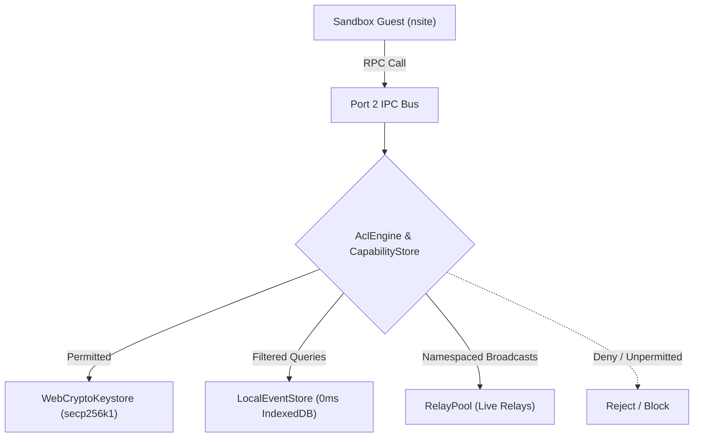

# Omni — System Architecture & Core Runtime

> **Authoritative Reference for Developers, System Architects, and AI Agents.**  
> *Version 2.0 (Consolidated) — October 2026*

---

## 1. System Overview & Core Philosophy

Omni is an extensible, local-first Nostr web client and sandboxed micro-frontend runtime.

### The Fundamental Architectural Mandates
1. **Every Functional Domain is a Standalone Plugin**:
   - The timeline feed & composer (`@omni/plugin-feed`) is a plugin.
   - The relay inspector & connection manager (`@omni/plugin-relays`) is a plugin.
   - The profile editor & key custody manager (`@omni/plugin-profile`) is a plugin.
   - The task list (`@omni/plugin-checklist`) and focus timer (`@omni/plugin-timer`) are plugins.
   - The shell UI frame itself (`@omni/plugin-shell`) is a first-class plugin.
2. **Every Plugin is a 100% Standard Nostr Site (nsite)**:
   - There are **no proprietary manifests** (`omni.manifest.json` is completely eliminated).
   - Apps are standard web applications mounting to standard DOM (`document.body`).
   - If an author creates a companion widget (e.g. countdown timer or mini-card), it is published as its **own independent companion nsite** with its own `naddr`.
3. **Strict Shell vs. Kernel Separation**:
   - **Kernel (`@omni/core`) is Headless**: It owns sandboxing, WebCrypto keys, relay pooling, 0ms local event caching, capability security (ACL), and Remote DOM transport. It has zero awareness of UI layouts, slot semantics (`main`, `sidebar`, `dock`, `header-actions`), or user pages.
   - **Shell (`@omni/plugin-shell`) Owns All Presentation**: It owns viewports, layout management (`LayoutManager`), the desktop navigation dock, widgets dashboard grid, settings tabs, and NIP-78 workspace serialization.
4. **Zero Proprietary SDKs (`window.omni` Eliminated from Plugins)**:
   - Plugins are 100% unaware of Omni. No `omni.registerComponent`, no `omni.storage`, no `omni.profile`, and no `omni.relays`.
   - Plugins mount standard DOM directly to `document.body` or `#root`. The sandbox runtime automatically mirrors `document.body` across the Remote DOM bridge.
   - Sub-views and routes (`?view=settings`, `?view=widget`) are read via standard `window.location.search`.
   - Storage uses standard `window.localStorage` (transparently partitioned per plugin ID by the sandbox).
   - Identity & signing use standard `window.nostr` (NIP-07).
5. **User-Defined Viewports (Zero Hardcoded Slots)**:
   - Developers never declare or hardcode layout "slots".
   - The **user** assigns apps and chooses routes in Settings:
     - **Full-Page App** (`main`): Primary center viewport page with dedicated navigation dock link.
     - **Navigation Dock Shortcut** (`dock`): Quick launcher pinned to the navigation dock.
     - **Workspace Widget** (`sidebar`): Interactive card inside the multi-column Widgets Dashboard.
     - **Header Quick Action** (`header-actions`): Compact status icon/pill in top navigation.

---

## 2. Monorepo Repository Structure

Omni is structured as a `pnpm` monorepo:

```
omni/
├── apps/
│   └── web/                               # Host Web Shell & Bootloader (~30 lines)
│       ├── index.html                     # Minimal HTML skeleton (<div id="omni-root">)
│       ├── public/omni-runtime.js         # Injected guest sandbox runtime bridge
│       └── src/
│           ├── main.ts                    # Host microkernel bootloader & shell mount
│           └── style.css                  # Design tokens and responsive CSS
│
├── packages/
│   ├── types/                             # Canonical TypeScript interfaces
│   │   └── src/                           # NostrEvent, NostrFilter, OmniWorkspaceState, etc.
│   │
│   ├── core/                              # Orchestration & Security Runtime
│   │   ├── src/
│   │   │   ├── kernel/omni-kernel.ts      # OmniKernel: storage, ACL, sandboxes, relays
│   │   │   ├── acl/                       # CapabilityStore & AclEngine (permission governance)
│   │   │   ├── crypto/                    # WebCryptoKeystore (secp256k1, Schnorr, bech32)
│   │   │   ├── layout/                    # LayoutManager (viewport slot mapping & reparenting)
│   │   │   ├── nostr/                     # LocalEventStore (0ms hits), RelayPool, Coordinator
│   │   │   ├── plugins/                   # NostrPluginResolver (NIP-5A nsites, Blossom, naddr)
│   │   │   ├── remote-dom/                # RemoteDomHost (@remote-dom/core host receiver)
│   │   │   └── sandbox/                   # SandboxInstance & default-runtime.ts
│   │   └── test/                          # Unit & integration tests (vitest + happy-dom)
│   │
│   └── plugins/                           # Modular First-Class System Plugins
│       ├── shell/                         # @omni/plugin-shell (Header, dock, pages, settings)
│       ├── feed/                          # @omni/plugin-feed (Timeline notes & note composer)
│       ├── relays/                        # @omni/plugin-relays (Relay inspector & manager)
│       ├── profile/                       # @omni/plugin-profile (Identity & key custody)
│       ├── checklist/                     # @omni/plugin-checklist (Daily checklist widget)
│       └── timer/                         # @omni/plugin-timer (Focus timer / Pomodoro)
```

---

## 3. Microkernel Bootloader & Pluggable Shell

Omni separates the **execution kernel** from the **user interface frame**:

```
┌─────────────────────────────────────────────────────────────┐
│                    Host Browser Window                      │
│                                                             │
│   apps/web/src/main.ts                                      │
│   • Boots OmniKernel (keystore, relay pool, storage)        │
│   • Loads saved NIP-78 / local workspace viewports          │
│   • Mounts @omni/plugin-shell into #omni-root               │
└──────────────────────────┬──────────────────────────────────┘
                           │ Mounts UI frame
                           ▼
┌─────────────────────────────────────────────────────────────┐
│                  @omni/plugin-shell (UI Frame)              │
│                                                             │
│   • Header (User Badge, NIP-05 / npub display, sync state)  │
│   • Navigation Dock (Page links, Widgets Dashboard, Settings│
│   • View Router (Full-Page Apps vs Widgets Dashboard)       │
│   • Settings Modal (Identity, Relays, Plugins & Viewports)  │
│   • Container Slots (mainSlot, widgetsSlot, dockSlot)       │
└──────────────────────────┬──────────────────────────────────┘
                           │ Supplies container elements
                           ▼
┌─────────────────────────────────────────────────────────────┐
│                   OmniKernel Sandbox Engine                 │
│                                                             │
│   Projects sandboxed nsites into shell container slots:     │
│   • Feed App ──> #slot-main                                 │
│   • Timer Widget ──> #slot-widgets                          │
│   • Daily Checklist ──> #slot-widgets                       │
│   • Custom nsite ──> #page-app-<id> or #slot-widgets        │
└─────────────────────────────────────────────────────────────┘
```

### 3.1 Minimal Bootloader (`apps/web/index.html` & `main.ts`)
- `index.html` contains zero hardcoded feature markup: strictly a responsive viewport `<div id="omni-root"></div>`.
- `main.ts` does only:
  1. Instantiates `OmniKernel` with default relays (`wss://relay.damus.io`, `wss://relay.ditto.pub`).
  2. Instantiates `OmniShell` passing `#omni-root`.
  3. Restores saved workspace state (`shell.loadInitialWorkspace()`) so plugins initialize directly into user-assigned viewports.
  4. Calls `kernel.boot()` and mounts plugins into their containers.

### 3.2 Page-Centric Routing & Navigation
- The host supports **distinct center pages**:
  - Each app assigned to `Full-Page App` (`main`) gets its own dedicated full-width center `<section class="app-page">`.
  - The navigation dock automatically renders launcher buttons for all installed full-page apps.
  - Clicking an app in the dock smoothly brings that app into view while resetting scroll positions.
  - The **Widgets & Tools Dashboard** (`widgets`) renders all companion widgets together in a multi-column responsive workspace.

---

## 4. Sandboxing & Dual-Channel Remote DOM Execution

Untrusted third-party nsites run inside isolated `<iframe>` sandboxes (`sandbox="allow-scripts"`, `connect-src 'none'`), fully air-gapped from direct network access, origin storage, or raw cryptographic keys.

### 4.1 Dual-Channel IPC Model
Communication between host and sandbox occurs over an HTML5 `MessageChannel`:

```
┌──────────────────────────────────────┐          ┌──────────────────────────────────────┐
│           Sandbox Guest              │          │              Host Kernel             │
│                                      │          │                                      │
│  UI Element Mutations                │  Port 1  │  RemoteDomHost                       │
│  (@remote-dom/core RemoteRoot)       ├─────────►│  (Projects to host native DOM)       │
│                                      │          │                                      │
│  Capability RPC Bus                  │  Port 2  │  Kernel Dispatcher                   │
│  (JSON-RPC 2.0: nostr, storage, uri) ◄─────────►│  (ACL Engine, RelayPool, Keystore)   │
└──────────────────────────────────────┘          └──────────────────────────────────────┘
```

1. **Port 1 (Remote DOM Mutation Stream)**:
   - Uses Shopify's `@remote-dom/core`.
   - Serializes DOM mutation operations (create, append, text update, remove) across the boundary.
   - The host projects these mutations into native DOM elements within the user's selected container.
   - **Zero iframe styling boundaries**: Guest elements inherit host design tokens and CSS variables seamlessly.
2. **Port 2 (Capability JSON-RPC Bus)**:
   - Routes typed JSON-RPC 2.0 method invocations (`kernel.handleUri`, `kernel.handleShare`, `nostr.subscribe`, `nostr.publish`, `storage.get/set`).
   - Governed by `CapabilityStore` and `AclEngine`.

### 4.2 Critical Remote DOM Runtime Invariants
- **Detached Tree Construction**: Always create elements detached, configure attributes and children, and append to the container at the end.
- **`isConnected()` Traversal Check**: The sandbox `RemoteNode` enforces `this.isConnected()`. Property and attribute mutations (`Mutation 3`) are only dispatched over IPC if the node is actively connected to the root (`~`). This prevents out-of-order mutations on detached nodes.
- **Root ID (`~`) Interception**: `RemoteDomHost.mutate()` intercepts property mutations targeting `"~"` and applies them directly to the host container element, bypassing `DOMRemoteReceiver` which does not index `"~"`.

---

## 5. Transparent API Virtualization

Developers build regular web applications without custom SDKs. The sandbox runtime (`omni-runtime.js`) transparently provides:

### 5.1 Standard Identity & Signer (`window.nostr` / NIP-07)
- Injected into the sandbox global scope:
  - `getPublicKey(): Promise<string>`
  - `signEvent(draft): Promise<NostrEvent>`
  - `getRelays(): Promise<Record<string, { read: boolean; write: boolean }>>`
  - `nip04.encrypt(pubkey, text)` / `nip04.decrypt(pubkey, cipher)`
  - `nip44.encrypt(pubkey, text)` / `nip44.decrypt(pubkey, cipher)`
- Calls are validated by the host `AclEngine` before signing via `WebCryptoKeystore`.

### 5.2 Transparent Relay Networking (Virtual `window.WebSocket`)
- Untrusted sandboxes run with strict CSP (`connect-src 'none'`).
- The sandbox runtime provides a drop-in virtual `window.WebSocket`:
  ```javascript
  // Standard nostr-tools or client library inside sandbox:
  const ws = new WebSocket("wss://relay.damus.io");
  ws.send(JSON.stringify(["REQ", "my-sub", { kinds: [1], limit: 20 }]));
  ```
- Translates Nostr relay frames (`REQ`, `EVENT`, `CLOSE`) into host IPC messages, routed through Omni's high-performance `RelayPool` and 0ms local event cache.

### 5.3 Transparent Storage (`localStorage` & `indexedDB`)
- The host transparently isolates local storage per `pluginId`.
- Standard `localStorage.getItem()` / `setItem()` and IndexedDB instances are scoped, preventing cross-plugin inspection or tampering.

### 5.4 Automatic DOM Mirroring (`document.body`)
- The sandbox runtime observes mutations to `document.body` and automatically mirrors them into the Remote DOM tree. Developers write standard HTML or React/Svelte mounting to `#root` without custom registration.

---

## 6. Security, Isolation & Access Control



1. **Privilege Separation**:
   - **System Plugins** (`org.omni.plugin.*` or `trusted: true`): Run with `sandbox="allow-scripts allow-same-origin"` to allow local resource resolution.
   - **Third-Party nsites**: Run air-gapped (`sandbox="allow-scripts"`, `connect-src 'none'`), fully isolated from cookies, local origins, and host keys.
2. **Subscription Namespacing**:
   - Every subscription opened by a plugin is prefixed with the requesting plugin ID (`${pluginId}:${subId}`).
   - Incoming relay frames (`EVENT`, `EOSE`) are routed strictly to the requesting plugin's IPC port. Data requested by App A cannot leak into App B.
3. **ACL-Governed Local Cache Filtering**:
   - When plugins query the shared `LocalEventStore` (0ms IndexedDB cache), the kernel's `AclEngine` filters the result set:
     - Public notes (`kind: 1`): Allowed if `nostr:read` is granted.
     - Encrypted DMs (`kind: 4`, `kind: 1059`): Strictly blocked unless the plugin has explicit user permission for encrypted messaging.
