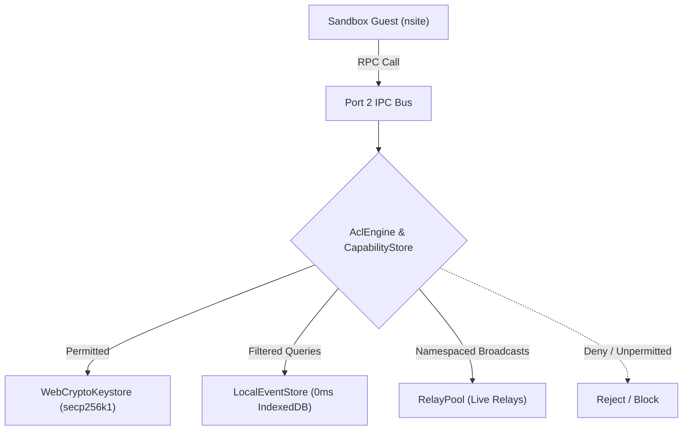

# Omni — System Architecture & Core Runtime

> **Authoritative Reference for Developers, System Architects, and AI Agents.**  
> *Version 2.0 (Consolidated) — October 2026*

---

## 1. System Overview & Core Philosophy

Omni is an extensible, local-first Nostr web client and sandboxed micro-frontend runtime.

### The Fundamental Architectural Mandates
1. **Every Functional Domain is a Standalone Plugin**:
   - The timeline feed & composer (`@omni/plugin-feed`) is a plugin.
   - The relay inspector & connection manager (`@omni/plugin-relays`) is a plugin.
   - The profile editor & key custody manager (`@omni/plugin-profile`) is a plugin.
   - The task list (`@omni/plugin-checklist`) is a plugin.
   - The shell UI frame itself (`@omni/plugin-shell`) is a first-class plugin.
2. **Every Plugin is a 100% Standard Nostr Site (nsite)**:
   - There are **no proprietary manifests** (`omni.manifest.json` is completely eliminated).
   - Apps are standard web applications mounting to standard DOM (`document.body`).
   - If an author creates a companion widget (e.g. countdown timer or mini-card), it is published as its **own independent companion nsite** with its own `naddr`.
3. **Strict Shell vs. Kernel Separation**:
   - **Kernel (`@omni/core`) is Headless**: It owns sandboxing, WebCrypto keys, relay pooling, 0ms local event caching, capability security (ACL), and Remote DOM transport. It has zero awareness of UI layouts, slot semantics (`main`, `sidebar`, `dock`, `header-actions`), or user pages.
   - **Shell (`@omni/plugin-shell`) Owns All Presentation**: It owns viewports, layout management (`LayoutManager`), the desktop navigation dock, widgets dashboard grid, settings tabs, and NIP-78 workspace serialization.
4. **Zero Proprietary SDKs (`window.omni` Eliminated from Plugins)**:
   - Plugins are 100% unaware of Omni. No `omni.registerComponent`, no `omni.storage`, no `omni.profile`, and no `omni.relays`.
   - Plugins mount standard DOM directly to `document.body` or `#root`. The sandbox runtime automatically mirrors `document.body` across the Remote DOM bridge.
   - Sub-views and routes (`?view=settings`, `?view=widget`) are read via standard `window.location.search`.
   - Storage uses standard `window.localStorage` (transparently partitioned per plugin ID by the sandbox).
   - Identity & signing use standard `window.nostr` (NIP-07).
5. **User-Defined Viewports (Zero Hardcoded Slots)**:
   - Developers never declare or hardcode layout "slots".
   - The **user** assigns apps and chooses routes in Settings:
     - **Full-Page App** (`main`): Primary center viewport page with dedicated navigation dock link.
     - **Navigation Dock Shortcut** (`dock`): Quick launcher pinned to the navigation dock.
     - **Workspace Widget** (`sidebar`): Interactive card inside the multi-column Widgets Dashboard.
     - **Header Quick Action** (`header-actions`): Compact status icon/pill in top navigation.

---

## 2. Monorepo Repository Structure

Omni is structured as a `pnpm` monorepo:

```
omni/
├── apps/
│   └── web/                               # Host Web Shell & Bootloader (~30 lines)
│       ├── index.html                     # Minimal HTML skeleton (<div id="omni-root">)
│       └── src/
│           ├── main.ts                    # Host microkernel bootloader & shell mount
│           └── style.css                  # Minimal host microkernel skeleton reset (~25 lines)
│
├── packages/
│   ├── types/                             # Canonical TypeScript interfaces
│   │   └── src/                           # NostrEvent, NostrFilter, OmniWorkspaceState, etc.
│   │
│   ├── core/                              # Orchestration & Security Runtime
│   │   ├── src/
│   │   │   ├── kernel/omni-kernel.ts      # OmniKernel: storage, ACL, sandboxes, relays
│   │   │   ├── acl/                       # CapabilityStore & AclEngine (permission governance)
│   │   │   ├── crypto/                    # WebCryptoKeystore (secp256k1, Schnorr, bech32)
│   │   │   ├── layout/                    # LayoutManager (viewport slot mapping & reparenting)
│   │   │   ├── nostr/                     # LocalEventStore (0ms hits), RelayPool, Coordinator
│   │   │   ├── plugins/                   # NostrPluginResolver (NIP-5A nsites, Blossom, naddr)
│   │   │   ├── remote-dom/                # RemoteDomHost (@remote-dom/core host receiver)
│   │   │   └── sandbox/                   # SandboxInstance & omni-runtime.js (guest runtime bridge)
│   │   └── test/                          # Unit & integration tests (vitest + happy-dom)
│   │
│   └── plugins/                           # Modular First-Class System Plugins
│       ├── shell/                         # @omni/plugin-shell (Header, dock, pages, settings)
│       ├── feed/                          # @omni/plugin-feed (Timeline notes & note composer)
│       ├── relays/                        # @omni/plugin-relays (Relay inspector & manager)
│       ├── profile/                       # @omni/plugin-profile (Identity & key custody)
│       └── checklist/                     # @omni/plugin-checklist (Daily checklist widget)
```

---

## 3. Microkernel Bootloader & Swappable Shell Architecture

Omni enforces a strict architectural boundary between the **headless execution microkernel (`@omni/core`)** and the **presentation shell (`@omni/plugin-shell`)**:

```
┌───────────────────────────────────────────────────────────────────────────┐
│                           Host Browser Window                             │
│                                                                           │
│   apps/web/src/main.ts (Bootloader)                                       │
│   • Instantiates OmniKernel (keystore, relay pool, event cache, ACL)      │
│   • Instantiates OmniShell (or any custom swappable shell implementation) │
│   • Bridges Shell callbacks (slotResolver, handleUri, handleShare)        │
└───────────────────────────────┬───────────────────────────────────────────┘
                                │ Mounts native UI frame
                                ▼
┌───────────────────────────────────────────────────────────────────────────┐
│                    OmniShell Host (Presentation Layer)                    │
│                                                                           │
│   • Mounts into #omni-root with direct DOM control                        │
│   • Renders layout skeleton: Header, Navigation Dock, Pages, Widget Grid  │
│   • Defines & allocates physical slot containers (main, sidebar, dock...) │
│   • Manages Settings tabs, viewport dropdowns & route selectors           │
│   • Serializes workspace state to NIP-78 (kind: 30078, d: omni/workspace) │
└───────────────────────────────┬───────────────────────────────────────────┘
                                │ Supplies physical DOM container elements
                                ▼
┌───────────────────────────────────────────────────────────────────────────┐
│                  OmniKernel Sandbox Engine (Headless Layer)               │
│                                                                           │
│   Projects sandboxed nsites via Remote DOM into shell container slots:    │
│   • Timeline Feed     ──> getContainerForPluginSlot(id, "main")           │
│   • Focus Timer       ──> getContainerForPluginSlot(id, "sidebar")        │
│   • Daily Checklist   ──> getContainerForPluginSlot(id, "sidebar")        │
│   • Relay Manager     ──> getContainerForPluginSlot(id, "sidebar")        │
│   • Third-Party nsite ──> getContainerForPluginSlot(id, userSelectedSlot) │
└───────────────────────────────────────────────────────────────────────────┘
```

### 3.1 What Makes the Shell Unique: Host-Level Runtime Plugin vs. Sandboxed nsite

In Omni, there is a fundamental distinction between the Shell and regular plugins:

| Dimension | Sandboxed Plugin (nsite) | Presentation Shell (`@omni/plugin-shell`) |
| :--- | :--- | :--- |
| **Execution Environment** | Sandboxed `<iframe>` (`sandbox="allow-scripts"`, `null` origin) | Host browser thread (`http://localhost:5173` or host domain) |
| **DOM Access** | No access to host DOM; mounts to sandbox `document.body` | Direct access to `#omni-root` and window layout |
| **UI Projection** | Elements serialized across Remote DOM (Channel 1) | Renders native HTML/CSS containers that receive Remote DOM |
| **Storage Access** | Partitioned per `pluginId` by `PluginStorageManager` | Host origin `localStorage` (`omni_workspace_state`) |
| **Keystore Access** | NIP-07 `window.nostr` governed by `AclEngine` checks | Access to `kernel.keystore` for workspace backup & restore |
| **Role in App** | Independent domain app/widget (feed, timer, notes) | System container, layout manager, and user frame |

Because regular plugins are 100% standard nsites with no knowledge of the host or proprietary SDKs, **the Shell can be swapped out entirely** without modifying a single line of plugin code.

---

### 3.2 The Canonical Shell Contract (`OmniShellHost`)

Any alternative shell (e.g. a mobile bottom-navigation shell, a tiling desktop manager, or a keyboard-driven terminal UI) satisfies the canonical [`OmniShellHost`](file:///home/spiralnights/code/omni/packages/types/src/workspace.ts) contract:

```typescript
export interface OmniShellHost {
  /**
   * Mounts the shell layout and UI frame into the root host DOM element (#omni-root).
   */
  mount(): void;

  /**
   * Resolves physical DOM container elements for plugin viewports.
   * Called by the Kernel whenever a plugin or widget needs to project its UI.
   */
  getContainerForPluginSlot(
    pluginId: string, 
    viewport: string, 
    componentId?: string
  ): Element | undefined;

  /**
   * Optional: Handles drawer or slot toggle/open/close requests.
   */
  handleSlotAction?(action: "toggle" | "open" | "close", slot: string): void;

  /**
   * Optional: Handles protocol URIs (nostr:, lightning:, cashu:) intercepted at sandbox boundaries.
   */
  handleUri?(uri: string, sourcePluginId?: string): Promise<any>;

  /**
   * Optional: Handles Web Share API payload delegations.
   */
  handleShare?(payload: { title?: string; text?: string; url?: string }, sourcePluginId?: string): Promise<any>;

  /**
   * Exports the current workspace layout state for NIP-78 and local persistence.
   */
  exportWorkspaceState(): OmniWorkspaceState;
}
```

---

### 3.3 How Viewport Slots & Routing Work

#### 1. The Canonical Slot Definitions (`STANDARD_SLOTS`)
Omni defines standard layout slots in [`STANDARD_SLOTS`](file:///home/spiralnights/code/omni/packages/core/src/layout/layout-manager.ts):

| Slot ID | Canonical Name | Purpose |
| :--- | :--- | :--- |
| `main` | Full-Page App (Center View) | Primary full-width view with dedicated launcher in navigation dock |
| `sidebar` | Widgets Dashboard Card | Modular card in the multi-column workspace widgets grid |
| `dock` | Navigation Dock Shortcut | Compact button / companion icon pinned to the dock |
| `header-actions` | Header Quick Action | Top-right toolbar action or status indicator |
| `header-status` | Header Status Area | Reserved branding area next to logo |

#### 2. Slot Allocation Lifecycle
1. When `OmniShell` boots, it builds the physical DOM scaffold:
   - Header bar with `.header-right`
   - Navigation dock `<aside id="omni-dock">`
   - Main page container `<main id="omni-main-viewport">`
   - Widgets dashboard `<div id="omni-widgets-grid">`
2. When the user assigns a plugin to a viewport (e.g. Profile to `main`), `OmniShell.getContainerForPluginSlot(pluginId, viewport)` dynamically creates or returns the target element:
   - For `main`: `<div id="page-app-[safeId]" class="page-view">`
   - For `sidebar`: `<div class="widget-card">`
   - For `dock`: `<div class="dock-quick-view">`
   - For `header-actions`: `<div class="header-action-slot">`
3. The Kernel's `SandboxInstance` connects to this element and mounts a `RemoteDomHost` into it.

#### 3. How the Settings Page Discovers Available Slots
The Settings page is rendered by `OmniShell`. To ensure zero discrepancy between the layout engine and the user interface, `OmniShell` provides:
```typescript
public getAvailableViewports(): { id: string; label: string; description: string }[] {
  return STANDARD_SLOTS
    .filter((s) => s.id !== "header-status")
    .map((s) => ({ id: s.id, label: s.name, description: s.description }));
}
```
Both the **Plugins Overview** card and each plugin's **Dedicated Settings Tab** use `getAvailableViewports()` to populate the `<select class="plugin-viewport-select">` menus dynamically.

---

### 3.4 How to Swap Out the Shell

Because the microkernel bootloader (`apps/web/src/main.ts`) is cleanly decoupled from the shell, swapping the shell requires only replacing the shell instantiation:

```typescript
// apps/web/src/main.ts

import { OmniKernel } from "@omni/core";
// Replace standard shell with custom mobile or tiling shell:
import { MyCustomMobileShell } from "@my-org/omni-mobile-shell";

// 1. Initialize Headless Kernel
const kernel = new OmniKernel({
  bootstrapRelays: ["wss://relay.damus.io", "wss://relay.ditto.pub"],
  slotResolver: (pluginId, compId, slot) => shell?.getContainerForPluginSlot(pluginId, slot, compId),
  onHandleUri: (uri, srcId) => shell?.handleUri(uri, srcId),
  onHandleShare: (payload, srcId) => shell?.handleShare(payload, srcId)
});

// 2. Initialize Custom Shell
const rootEl = document.getElementById("omni-root")!;
const shell = new MyCustomMobileShell({ root: rootEl, kernel, installedPlugins: initialPlugins });

// 3. Mount UI and Boot Kernel
shell.mount();
await kernel.boot();
```

All existing plugins (`@omni/plugin-feed`, `@omni/plugin-relays`, `@omni/plugin-checklist`, etc.) immediately render inside `MyCustomMobileShell` with zero code modifications.

---

### 3.5 Decentralized Workspace Synchronization (NIP-78)

1. **State Persistence**:
   - Layout configurations, viewport assignments, enabled states, and custom routes serialize to `OmniWorkspaceState` (`kind: 30078`, tag `["d", "omni/workspace/v1"]`).
   - Backed by 0ms local storage fallback in host `localStorage` (`omni_workspace_state`).
2. **Security Reservation**:
   - `AclEngine` and `JsonRpcDispatcher` restrict the `omni/*` NIP-78 namespace to the host Shell. Untrusted guest plugins cannot sign or publish `kind: 30078` events tagged `omni/*`.

---

### 3.6 Decoupled Shell Styling & Dynamic Shell Registry

#### 1. Per-Shell Style Ownership
- The host bootloader (`apps/web/src/style.css`) is strictly a minimal microkernel reset (~25 lines) defining box-sizing, background, and `#omni-root` bounds.
- The active Shell owns all visual styling, layout rules, typography, and standard design tokens (`--bg-canvas`, `--bg-surface`, `--text-primary`, `--accent-primary`).
- Each shell encapsulates its own stylesheet self-contained in `packages/plugins/shell/src/styles/`:
  - `classic-styles.ts` (`CLASSIC_SHELL_CSS`): Warm Paper Dark design system, dock navigation, and multi-viewport workbench.
  - `panorama-styles.ts` (`PANORAMA_SHELL_CSS`): Windows Phone Metro / People Hub panoramic canvas, flat live tiles, and fluid horizontal swipe.
- Upon `shell.mount()`, the active shell calls `mountShellStyles(css)` which dynamically injects `<style id="omni-active-shell-style">` into `<head>`. Calling `shell.destroy()` removes it cleanly, preventing style conflicts or cross-contamination.

#### 2. First-Class Swappable Shell Registry (`ShellRegistry`)
- Shells are registered in `shellRegistry` with metadata (`id`, `name`, `description`, `author`, `version`, `create` factory).
- The bootloader dynamically instantiates the user's active shell via:
  ```typescript
  const shell = shellRegistry.create(activeShellType, {
    root: rootEl,
    kernel,
    installedPlugins: initialPlugins
  });
  ```
- The shell selector in Settings automatically enumerates all registered shells from `shellRegistry.list()`, enabling users to install new shell plugins and switch experiences dynamically without code changes.

---

## 4. Sandboxing & Dual-Channel Remote DOM Execution

Untrusted third-party nsites run inside isolated `<iframe>` sandboxes (`sandbox="allow-scripts"`, `connect-src 'none'`), fully air-gapped from direct network access, origin storage, or raw cryptographic keys.

### 4.1 Dual-Channel IPC Model
Communication between host and sandbox occurs over an HTML5 `MessageChannel`:

```
┌──────────────────────────────────────┐          ┌──────────────────────────────────────┐
│           Sandbox Guest              │          │              Host Kernel             │
│                                      │          │                                      │
│  UI Element Mutations                │  Port 1  │  RemoteDomHost                       │
│  (@remote-dom/core RemoteRoot)       ├─────────►│  (Projects to host native DOM)       │
│                                      │          │                                      │
│  Capability RPC Bus                  │  Port 2  │  Kernel Dispatcher                   │
│  (JSON-RPC 2.0: nostr, storage, uri) ◄─────────►│  (ACL Engine, RelayPool, Keystore)   │
└──────────────────────────────────────┘          └──────────────────────────────────────┘
```

1. **Port 1 (Remote DOM Mutation Stream)**:
   - Uses Shopify's `@remote-dom/core`.
   - Serializes DOM mutation operations (create, append, text update, remove) across the boundary.
   - The host projects these mutations into native DOM elements within the user's selected container.
   - **Zero iframe styling boundaries**: Guest elements inherit host design tokens and CSS variables seamlessly.
2. **Port 2 (Capability JSON-RPC Bus)**:
   - Routes typed JSON-RPC 2.0 method invocations (`kernel.handleUri`, `kernel.handleShare`, `nostr.subscribe`, `nostr.publish`, `storage.get/set`).
   - Governed by `CapabilityStore` and `AclEngine`.

### 4.2 Critical Remote DOM Runtime Invariants
- **Detached Tree Construction**: Always create elements detached, configure attributes and children, and append to the container at the end.
- **`isConnected()` Traversal Check**: The sandbox `RemoteNode` enforces `this.isConnected()`. Property and attribute mutations (`Mutation 3`) are only dispatched over IPC if the node is actively connected to the root (`~`). This prevents out-of-order mutations on detached nodes.
- **Root ID (`~`) Interception**: `RemoteDomHost.mutate()` intercepts property mutations targeting `"~"` and applies them directly to the host container element, bypassing `DOMRemoteReceiver` which does not index `"~"`.

---

## 5. Transparent API Virtualization

Developers build regular web applications without custom SDKs. The sandbox runtime (`omni-runtime.js`) transparently provides:

### 5.1 Standard Identity & Signer (`window.nostr` / NIP-07)
- Injected into the sandbox global scope:
  - `getPublicKey(): Promise<string>`
  - `signEvent(draft): Promise<NostrEvent>`
  - `getRelays(): Promise<Record<string, { read: boolean; write: boolean }>>`
  - `nip04.encrypt(pubkey, text)` / `nip04.decrypt(pubkey, cipher)`
  - `nip44.encrypt(pubkey, text)` / `nip44.decrypt(pubkey, cipher)`
- Calls are validated by the host `AclEngine` before signing via `WebCryptoKeystore`.

### 5.2 Transparent Relay Networking (Virtual `window.WebSocket`)
- Untrusted sandboxes run with strict CSP (`connect-src 'none'`).
- The sandbox runtime provides a drop-in virtual `window.WebSocket`:
  ```javascript
  // Standard nostr-tools or client library inside sandbox:
  const ws = new WebSocket("wss://relay.damus.io");
  ws.send(JSON.stringify(["REQ", "my-sub", { kinds: [1], limit: 20 }]));
  ```
- Translates Nostr relay frames (`REQ`, `EVENT`, `CLOSE`) into host IPC messages, routed through Omni's high-performance `RelayPool` and 0ms local event cache.

### 5.3 Transparent Storage (`localStorage` & `indexedDB`)
- The host transparently isolates local storage per `pluginId`.
- Standard `localStorage.getItem()` / `setItem()` and IndexedDB instances are scoped, preventing cross-plugin inspection or tampering.

### 5.4 Automatic DOM Mirroring (`document.body`)
- The sandbox runtime observes mutations to `document.body` and automatically mirrors them into the Remote DOM tree. Developers write standard HTML or React/Svelte mounting to `#root` without custom registration.

---

## 6. Security, Isolation & Access Control



1. **Privilege Separation**:
   - **System Plugins** (`org.omni.plugin.*` or `trusted: true`): Run with `sandbox="allow-scripts allow-same-origin"` to allow local resource resolution.
   - **Third-Party nsites**: Run air-gapped (`sandbox="allow-scripts"`, `connect-src 'none'`), fully isolated from cookies, local origins, and host keys.
2. **Subscription Namespacing**:
   - Every subscription opened by a plugin is prefixed with the requesting plugin ID (`${pluginId}:${subId}`).
   - Incoming relay frames (`EVENT`, `EOSE`) are routed strictly to the requesting plugin's IPC port. Data requested by App A cannot leak into App B.
3. **ACL-Governed Local Cache Filtering**:
   - When plugins query the shared `LocalEventStore` (0ms IndexedDB cache), the kernel's `AclEngine` filters the result set:
     - Public notes (`kind: 1`): Allowed if `nostr:read` is granted.
     - Encrypted DMs (`kind: 4`, `kind: 1059`): Strictly blocked unless the plugin has explicit user permission for encrypted messaging.
