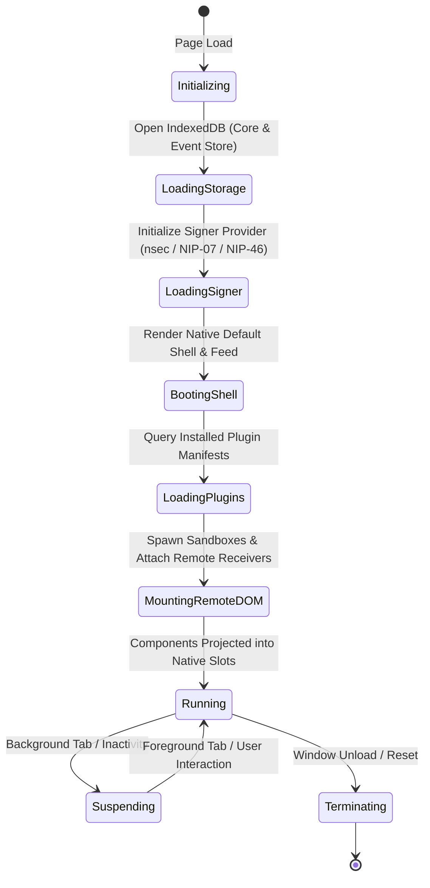

# 02. Host Core & Kernel Architecture

## 1. Overview & Host Architecture

The **Omni Host** is composed of two coordinated layers running in the primary browser window context:
1. **The Native Web Client Shell:** A high-performance, accessible Nostr application delivering the default navigation header, identity controls, note composer, timeline feed, and native layout slots.
2. **The Host Micro-Kernel:** The authoritative boundary for security, cryptographic signing, relay multiplexing, local IndexedDB caching, and plugin sandboxing.

```
+---------------------------------------------------------------------------------------+
|                                    Omni Host Shell                                    |
|  +---------------------------------------------------------------------------------+  |
|  | Native Web Client UI (Header, Live Timeline Feed, Note Composer, Design Tokens)  |  |
|  +---------------------------------------------------------------------------------+  |
|  | Native Layout Slots: [slot: dock]   [slot: sidebar]   [slot: main]   [slot: ...] |  |
|  +---------------------------------------------------------------------------------+  |
|                                           |                                           |
|  +---------------------------------------------------------------------------------+  |
|  |                             Host Remote DOM Host                                |  |
|  |         (RemoteReceiver per Slot, Native Element Mapping, Theme Tokens)         |  |
|  +---------------------------------------------------------------------------------+  |
|                                           |                                           |
|  +----------------------------------------+----------------------------------------+  |
|  |                                  Omni Kernel                                    |  |
|  |  +------------------------+  +-------------------------+  +-------------------+  |  |
|  |  |     Boot Manager       |  |   Plugin Registry & DB  |  | Capability / ACL  |  |  |
|  |  | (Lifecycle & Preload)  |  | (Installed Manifests)   |  | (Grants & Quotas) |  |  |
|  |  +------------------------+  +-------------------------+  +-------------------+  |  |
|  |               |                           |                           |          |  |
|  |  +----------------------------------------------------------------------------+  |  |
|  |  |                            Host RPC Dispatcher                             |  |  |
|  |  |              (JSON-RPC 2.0 Request Validation & Rate Limiting)             |  |  |
|  |  +----------------------------------------------------------------------------+  |  |
|  |          |                         |                         |              |    |  |
|  |          v                         v                         v              v    |  |
|  |  +---------------+        +-----------------+        +---------------+  +-----+  |  |
|  |  | Layout Engine |        |  Intent Broker  |        | Nostr Engine  |  | IDB |  |  |
|  |  | (Slot Manager)|        | (Action Router) |        | (Relays/Pool) |  | Store| |  |
|  |  +---------------+        +-----------------+        +---------------+  +-----+  |  |
|  +---------------------------------------------------------------------------------+  |
+---------------------------------------------------------------------------------------+
```

---

## 2. Kernel Lifecycle



### Phase 1: Initialization (`Initializing`)
* Verify browser environment features (`IndexedDB`, `ResizeObserver`, `MessageChannel`, `WebCrypto`).
* Instantiate internal system event buses (`HostEventBus`) and diagnostic logger.

### Phase 2: Storage & Keystore Boot (`LoadingStorage` & `LoadingSigner`)
* Open Omni's IndexedDB database (`omni_kernel_db`).
* Read active identity pubkey, bootstrap relay list (NIP-65), and stored capability grants.
* Initialize cryptographic signer provider (local encrypted WebCrypto keystore, browser extension NIP-07, or NIP-46 Remote Bunker).

### Phase 3: Native Shell & Feed Boot (`BootingShell`)
* Render the default web client UI: header navigation, profile status, relay indicator, and note composer.
* Register default native layout slots: `dock`, `sidebar`, `main`, and dynamic widget slots.
* Initialize the local-first timeline feed subscription (instant 0ms cache hits from IndexedDB + live relay streaming).

### Phase 4: Plugin Sandbox & Remote DOM Mount (`LoadingPlugins` & `MountingRemoteDOM`)
* Query installed plugin manifests (`omni.manifest.json`).
* Spawn isolated sandbox execution contexts (sandboxed `<iframe>` or Web Worker) with strict CSP `connect-src 'none'`.
* Establish dual-port `MessageChannel`:
  - **Port 1 (Remote DOM):** Connects plugin's `RemoteRoot` to the host's `RemoteReceiver` at the designated slot container.
  - **Port 2 (Kernel RPC):** JSON-RPC 2.0 communication channel for Nostr subscriptions, signing requests, storage, and intents.

### Phase 5: Operational Runtime (`Running`)
* Handle RPC requests from mounted plugins (Nostr queries, signed event broadcasting, storage access).
* Dispatch cross-plugin intents (direct RPC, interactive Remote DOM modals/sheets, pub/sub).
* Stream live Nostr events to both the native default feed and subscribed plugin components.

---

## 3. Capability Manager & ACL Engine

Omni operates on a strict **Zero-Trust Capability Security Model**. A plugin has zero implicit access to the Nostr protocol, user data, network, or other plugins unless explicitly declared in its manifest and granted by the user.

### 3.1. Permission Categories

| Category | Identifier | Scope / Parameters | Description |
| :--- | :--- | :--- | :--- |
| **Event Read** | `nostr:read` | `kinds: number[]`, `authors?: string[]` | Permission to subscribe to and read specific Nostr event kinds. |
| **Event Write** | `nostr:write` | `kinds: number[]` | Permission to request signing and publishing of specific event kinds. |
| **Signing & Crypto** | `nostr:sign` / `nostr:encrypt` | `nip04: boolean`, `nip44: boolean` | Permission to request cryptographic signatures or decrypt payloads. |
| **Intent Access** | `intent:call` / `intent:handle` | `action: string` (e.g., `wallet.send-payment`, `social.view-profile`) | Permission to emit or register handlers for specific intent actions. |
| **Storage** | `storage:scoped` | `quotaMb: number` | Isolated key-value storage within the Host IndexedDB. |

### 3.2. Permission Grant Levels
1. **Permanent (`Grant::Always`):** Stored in `omni_kernel_db` and persists across sessions.
2. **Session-Only (`Grant::Session`):** Valid until the browser tab or session closes.
3. **One-Time (`Grant::Once`):** Consumed immediately upon execution (e.g. single transaction or zap).
4. **Denied (`Grant::Deny`):** Automatically rejected without prompting the user.

### 3.3. Capability Enforcement Pipeline

```
[ Plugin JSON-RPC Request ]
            |
            v
[ Parse Method & Context ]
            |
            v
+------------------------------------+
| Check Capability Manifest & Grants |
+------------------------------------+
            |
    +-------+-------+
    |               |
 [Granted]     [Not Found]
    |               |
    |               v
    |     +---------------------+
    |     | Display Host Dialog | ---> [User Denies] ---> Reject RPC (-32001)
    |     +---------------------+
    |               |
    |          [User Allows]
    |               |
    +---------------+
            |
            v
[ Execute Action in Host Core ]
            |
            v
[ Return Response over postMessage / Port 2 ]
```

---

## 4. Host System Bus & State Management

The Host Core maintains an internal reactive state store:
* **Active User Identity:** Public key, relay list (NIP-65), metadata cache (kind 0), and active signer handle.
* **Plugin Registry:** In-memory registry of installed plugins, component declarations, active sandboxes, and granted capabilities.
* **Layout Slot Registry:** Active layout configuration, registered slot IDs (`dock`, `sidebar`, `main`, etc.), and active Remote DOM receivers.
* **Subscription Table:** Map of active plugin subscription IDs to multiplexed host Nostr subscriptions.

All state transitions emit events on the internal `HostEventBus`, allowing subsystems to react to session changes, connection drops, and layout reconfigurations cleanly.

