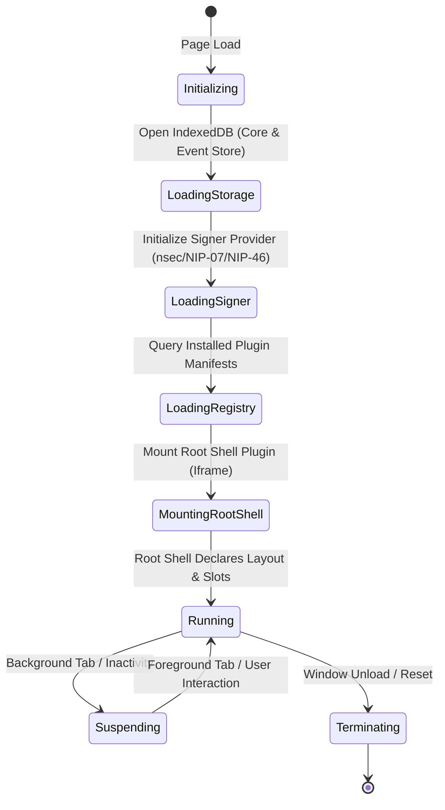

# 02. Host Core & Kernel Architecture

## 1. Overview & Kernel Responsibilities

The **Omni Host Core** is the micro-kernel of the application. It runs in the top-level browser browsing context (the main window/tab) and serves as the authoritative boundary for security, data storage, networking, and layout orchestration.

The Host Core intentionally avoids rendering application features or domain-specific Nostr UI components. Instead, it exposes an asynchronous runtime API to sandboxed plugins and enforces security policies at every call boundary.

```
+---------------------------------------------------------------------------------------+
|                                    Omni Host Kernel                                   |
|                                                                                       |
|  +------------------------+  +-------------------------+  +------------------------+  |
|  |     Boot Manager       |  |   Plugin Registry & DB  |  |  Capability & ACL Mgr  |  |
|  | (Lifecycle & Preload)  |  | (Installed Manifests)   |  | (Grants, Scopes, Tiers)|  |
|  +------------------------+  +-------------------------+  +------------------------+  |
|               |                           |                           |               |
|  +---------------------------------------------------------------------------------+  |
|  |                              Host RPC Dispatcher                                |  |
|  |                (JSON-RPC 2.0 Request Validation & Rate Limiting)                |  |
|  +---------------------------------------------------------------------------------+  |
|          |                         |                         |              |         |
|          v                         v                         v              v         |
|  +---------------+        +-----------------+        +---------------+  +----------+  |
|  | Layout Engine |        |  Intent Engine  |        | Nostr Engine  |  | Storage  |  |
|  |  (Slot Host)  |        |  (Broker/Router)|        | (Relays/Pool) |  | (IDB KV) |  |
|  +---------------+        +-----------------+        +---------------+  +----------+  |
+---------------------------------------------------------------------------------------+
```

---

## 2. Kernel Lifecycle



### Phase 1: Initialization (`Initializing`)
* Initialize WebCrypto subsystems and verify browser environment features (`IndexedDB`, `ResizeObserver`, `MessageChannel`).
* Instantiate internal system event buses and logger.

### Phase 2: Storage & Keystore Boot (`LoadingStorage` & `LoadingSigner`)
* Open Omni's internal IndexedDB database (`omni_kernel_db`).
* Read active user profile identity, relay configuration (NIP-65 bootstrap list), and installed plugin manifests.
* If a local encrypted keystore exists, await user unlock / passphrase or re-establish NIP-46 Remote Bunker session.

### Phase 3: Root Shell Mounting (`MountingRootShell`)
* Identify the user-designated **Root Shell Plugin** (e.g. `omni-default-shell`).
* Construct the root layout container in the DOM.
* Spawn the Root Shell iframe sandbox and execute the initialization handshake.

### Phase 4: Operational Runtime (`Running`)
* Listen for IPC requests from mounted plugins.
* Dispatch intent messages, multiplex relay subscriptions, process publishing requests, and synchronize slot dimensions.

---

## 3. Capability Manager & ACL Engine

Omni operates on a strict **Zero-Trust Capability Security Model**. A plugin has zero implicit access to the Nostr protocol, user data, network, or other plugins unless explicitly granted by the user.

### 3.1. Permission Categories

| Category | Identifier | Scope / Parameters | Description |
| :--- | :--- | :--- | :--- |
| **Event Read** | `nostr:read` | `kinds: number[]`, `authors?: string[]` | Permission to subscribe to and read specific Nostr event kinds. |
| **Event Write** | `nostr:write` | `kinds: number[]` | Permission to request signing and publishing of specific event kinds. |
| **Key Operations** | `nostr:sign_nip04` / `nostr:sign_nip44` | `pubkeys?: string[]`, `batch: boolean` | Permission to decrypt direct messages or encrypted payloads. |
| **Intent Access** | `intent:call` / `intent:handle` | `namespace: string` (e.g., `wallet.*`, `calendar.*`) | Permission to emit or register handlers for specific intent namespaces. |
| **Storage** | `storage:scoped` | `quotaMb: number` | Isolated key-value storage within the Host IndexedDB. |
| **Network Proxy**| `net:http_proxy` | `allowList: string[]` (domain/URL patterns) | Permission to make external HTTP fetch requests via host proxy. |

### 3.2. Permission Grant Levels
1. **Permanent (`Grant::Always`):** Stored in `omni_kernel_db` and persists across sessions.
2. **Session-Only (`Grant::Session`):** Valid until the browser tab or session closes.
3. **One-Time (`Grant::Once`):** Consumed immediately upon execution (e.g. single payment confirmation).
4. **Denied (`Grant::Deny`):** Automatically rejected without prompting the user.

### 3.3. Capability Enforcement Pipeline

```
[ Plugin JSON-RPC Request ]
            |
            v
[ Parse Method & Context ]
            |
            v
+------------------------------------+
| Check Capability Manifest & Grants |
+------------------------------------+
            |
    +-------+-------+
    |               |
 [Granted]     [Not Found]
    |               |
    |               v
    |     +---------------------+
    |     | Display Host Dialog | ---> [User Denies] ---> Reject RPC (-32001)
    |     +---------------------+
    |               |
    |          [User Allows]
    |               |
    +---------------+
            |
            v
[ Execute Action in Host Core ]
            |
            v
[ Return Response over postMessage ]
```

---

## 4. Host System Bus & State Management

The Host Core maintains an internal reactive state store:
* **Active User Profile:** Public key, relay list (NIP-65), metadata cache (kind 0), and active signer handle.
* **Plugin Registry:** In-memory index of installed plugins, active instances, allocated sandbox IDs, and granted permissions.
* **Layout Slot Registry:** Active layout configuration, registered slot IDs, mounted plugin instances, and dimension bounds.
* **Subscription Table:** Map of active plugin subscription IDs to multiplexed host Nostr subscriptions.

All state transitions emit events on the internal `HostEventBus`, allowing subsystems to react to session changes, connection drops, and layout reconfigurations cleanly.
