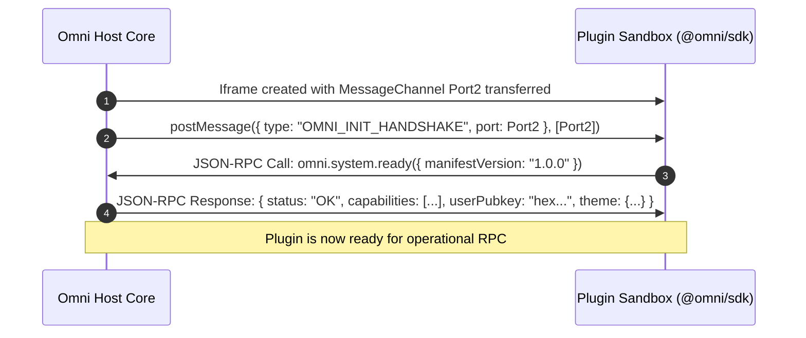

# 03. Sandbox & IPC Specification

## 1. Execution Sandboxing Boundary

To protect user private keys, prevent data exfiltration, and ensure application stability, every Omni plugin runs inside an isolated execution environment.

```
+------------------------------------------------------------------------------------+
|                                    Omni Host Context                               |
|                                                                                    |
|  +------------------------------------------------------------------------------+  |
|  |                           IPC Message Dispatcher                             |  |
|  |              (Origin Validation, Instance ID Check, Rate Limiter)            |  |
|  +------------------------------------------------------------------------------+  |
|         ^                                                ^                         |
|         | MessagePort (JSON-RPC 2.0)                     | MessagePort (JSON-RPC)  |
|         v                                                v                         |
|  +------------------------------+             +---------------------------------+  |
|  |     Visual UI Plugin         |             |      Background Service         |  |
|  |  <iframe sandbox=...>        |             |        Web Worker               |  |
|  |  CSP: connect-src 'none'     |             |  CSP: connect-src 'none'        |  |
|  |  Runs @omni/sdk UI bundle    |             |  Runs @omni/sdk headless task   |  |
|  +------------------------------+             +---------------------------------+  |
+------------------------------------------------------------------------------------+
```

### 1.1. Visual Plugins: Sandboxed Iframe
Visual plugins (full views, docked widgets, modals) execute within an `<iframe>` configured with strict isolation attributes:

```html
<iframe
  srcdoc="<!DOCTYPE html><html><head><meta http-equiv='Content-Security-Policy' content=&quot;default-src 'self' 'unsafe-inline' data: blob:; script-src 'unsafe-inline' 'self' blob:; connect-src 'none'; style-src 'self' 'unsafe-inline'; img-src data: blob: https:;&quot;><script src='blob:...'></script></head><body><div id='omni-root'></div></body></html>"
  sandbox="allow-scripts"
  data-plugin-id="org.nostr.feed"
  data-instance-id="inst_8f93a1"
  data-slot-id="slot_main_content"
  style="border: none; width: 100%; height: 100%; display: block;"
></iframe>
```

#### Sandbox Attributes Explained:
* `sandbox="allow-scripts"`: Enables JavaScript execution inside the iframe.
* **Omitted `allow-same-origin`**: Forces the iframe into a unique, opaque origin (`null`). This prevents the plugin from accessing host `localStorage`, `sessionStorage`, `IndexedDB`, cookies, or manipulating the host DOM.
* **Omitted `allow-top-navigation` / `allow-popups`**: Disallows opening new browser windows or redirecting the parent client.

### 1.2. Strict Content Security Policy (CSP)
Every sandbox enforces:
```http
Content-Security-Policy: default-src 'self' 'unsafe-inline' data: blob:; script-src 'unsafe-inline' 'self' blob:; connect-src 'none'; img-src data: blob: https:;
```
* `connect-src 'none'`: Completely disables `fetch()`, `XMLHttpRequest`, `WebSocket`, `EventSource`, and `WebRTC` directly from the sandbox.
* **Consequence:** The plugin **cannot exfiltrate data** or connect directly to third-party tracking servers. All network traffic (Nostr relay queries and authorized external HTTP calls) must pass through Omni Host RPC, where capability rules are enforced.

### 1.3. Headless / Background Plugins: Web Workers
Non-visual background plugins (e.g. background notification indexers, cache warmers) run within dedicated Web Workers. Web Workers are spawned from a locked-down Blob URL with an equivalent CSP, communicating with the Host over a dedicated `MessagePort`.

---

## 2. IPC Protocol Specification (JSON-RPC 2.0)

Omni uses an asynchronous bidirectional JSON-RPC 2.0 protocol over `MessagePort` channels established during plugin mounting.

### 2.1. Handshake Sequence



### 2.2. Request & Response Envelopes

#### JSON-RPC Request (Plugin -> Host)
```json
{
  "jsonrpc": "2.0",
  "id": "req_01HP8XYZ",
  "method": "nostr.publish",
  "params": {
    "event": {
      "kind": 1,
      "content": "Hello Nostr from Omni Plugin!",
      "tags": [["t", "omni"]],
      "created_at": 1780000000
    }
  }
}
```

#### JSON-RPC Response (Host -> Plugin)
```json
{
  "jsonrpc": "2.0",
  "id": "req_01HP8XYZ",
  "result": {
    "id": "4e7a8...c3",
    "pubkey": "9a3f2...b1",
    "sig": "1b88f...90",
    "relays": ["wss://relay.damus.io", "wss://nos.lol"]
  }
}
```

#### JSON-RPC Error Envelope
```json
{
  "jsonrpc": "2.0",
  "id": "req_01HP8XYZ",
  "error": {
    "code": -32001,
    "message": "Permission Denied: Plugin org.nostr.feed does not have nostr:write permission for kind 1",
    "data": {
      "requiredPermission": "nostr:write",
      "kind": 1
    }
  }
}
```

### 2.3. Streaming Protocol for Nostr Subscriptions

For streaming data (e.g. `nostr.subscribe`), Omni uses channel notifications:

1. **Plugin starts subscription:**
```json
{
  "jsonrpc": "2.0",
  "id": "sub_call_101",
  "method": "nostr.subscribe",
  "params": {
    "subscriptionId": "feed_sub_1",
    "filters": [
      { "kinds": [1], "limit": 50 }
    ]
  }
}
```

2. **Host emits streaming events (Host -> Plugin Notification):**
```json
{
  "jsonrpc": "2.0",
  "method": "nostr.stream.event",
  "params": {
    "subscriptionId": "feed_sub_1",
    "event": {
      "id": "...",
      "pubkey": "...",
      "kind": 1,
      "content": "...",
      "tags": [],
      "created_at": 1780000000,
      "sig": "..."
    },
    "fromCache": true,
    "relay": "wss://relay.damus.io"
  }
}
```

3. **Host signals End-of-Stored-Events (EOSE):**
```json
{
  "jsonrpc": "2.0",
  "method": "nostr.stream.eose",
  "params": {
    "subscriptionId": "feed_sub_1"
  }
}
```

4. **Plugin terminates subscription:**
```json
{
  "jsonrpc": "2.0",
  "id": "unsub_call_102",
  "method": "nostr.unsubscribe",
  "params": {
    "subscriptionId": "feed_sub_1"
  }
}
```

---

## 3. Standard JSON-RPC Error Codes

| Code | Label | Description |
| :--- | :--- | :--- |
| `-32700` | `PARSE_ERROR` | Invalid JSON received by host parser. |
| `-32600` | `INVALID_REQUEST` | Request payload does not conform to JSON-RPC 2.0. |
| `-32601` | `METHOD_NOT_FOUND` | The requested method does not exist on the host API. |
| `-32602` | `INVALID_PARAMS` | Method parameters failed validation. |
| `-32603` | `INTERNAL_ERROR` | Unexpected internal host exception. |
| `-32001` | `PERMISSION_DENIED` | Plugin lacked required capability or user denied prompt. |
| `-32002` | `INTENT_UNRESOLVED` | No plugin available to fulfill the requested intent. |
| `-32003` | `SIGNER_REJECTED` | User or hardware signer rejected signature request. |
| `-32004` | `RATE_LIMIT_EXCEEDED` | Plugin exceeded RPC call or event publishing frequency limit. |
| `-32005` | `QUOTA_EXCEEDED` | Plugin exceeded local IndexedDB storage quota. |
