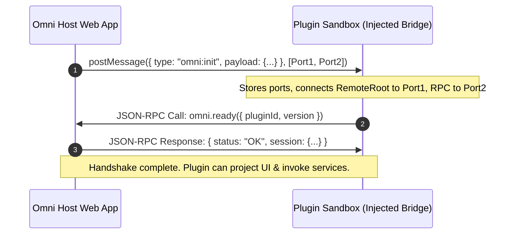

# 03. Sandbox & IPC Specification

## 1. Execution Sandboxing Boundary

To safeguard user private keys, prevent data exfiltration, and ensure the stability and security of the client, every Omni plugin executes inside a strictly sandboxed environment.

```
+------------------------------------------------------------------------------------+
|                                    Omni Host Context                               |
|                                                                                    |
|  +------------------------------------------------------------------------------+  |
|  |                           Host IPC Channel Dispatcher                        |  |
|  |              (Origin Validation, Instance ID Check, Rate Limiter)            |  |
|  +------------------------------------------------------------------------------+  |
|         ^                                                ^                         |
|         | Port 1 (Remote DOM Mutations)                  | Port 2 (Kernel JSON-RPC)|
|         v                                                v                         |
|  +------------------------------------------------------------------------------+  |
|  |                           Sandboxed Guest Execution                          |  |
|  |                           (<iframe sandbox="allow-scripts"> / Web Worker)    |  |
|  |                           Strict CSP: connect-src 'none'                     |  |
|  |                                                                              |  |
|  |   - Constructs Remote DOM element trees (Shopify @remote-dom/core)           |  |
|  |   - Zero access to Host DOM, cookies, localStorage, or raw crypto keys       |  |
|  |   - Interacts with Host via injected window.nostr (NIP-07) and window.omni bridge                |  |
|  +------------------------------------------------------------------------------+  |
+------------------------------------------------------------------------------------+
```

### 1.1. Sandbox Configuration
Guest plugins execute within an isolated headless container:
1. **Sandboxed `<iframe>`:**
   ```html
   <iframe
     srcdoc="<!DOCTYPE html><html><head><meta http-equiv='Content-Security-Policy' content=&quot;default-src 'none'; script-src 'unsafe-inline' blob: 'self'; style-src 'unsafe-inline';&quot;><script src='/omni-runtime.js'></script><script src='blob:plugin-code...'></script></head><body></body></html>"
     sandbox="allow-scripts"
     data-plugin-id="com.example.wallet"
     style="display: none;"
   ></iframe>
   ```
   * `sandbox="allow-scripts"`: Permits JavaScript execution inside the container.
   * **Omission of `allow-same-origin`**: Guarantees an opaque `null` origin, isolating the sandbox completely from the host's `localStorage`, IndexedDB, cookies, and DOM.
   * **Omission of `allow-popups` / `allow-top-navigation`**: Eliminates clickjacking and unauthorized parent window redirections.

2. **Web Worker Sandboxing:**
   For purely headless indexers or background tasks, plugins can run inside a dedicated Web Worker created from a locked Blob URL with an equivalent Content Security Policy.

### 1.2. Strict Content Security Policy (CSP)
Every sandbox enforces:
```http
Content-Security-Policy: default-src 'none'; script-src 'unsafe-inline' blob:; connect-src 'none';
```
* `connect-src 'none'`: Completely disables `fetch()`, `XMLHttpRequest`, `WebSocket`, `EventSource`, and `WebRTC` directly from the sandbox.
* **Security Consequence:** The plugin **cannot exfiltrate data** or connect directly to unauthorized external endpoints. All Nostr protocol traffic and network access must pass through Omni's capability-checked host broker.

---

## 2. Dual-Channel IPC Architecture

Communication between the Host and the Guest Sandbox occurs over a pair of dedicated `MessagePort` channels established during initialization:

```
[ Host Context ]                                         [ Guest Sandbox ]
       |                                                         |
       |============= Port 1: Remote DOM Tree ===================|
       |  (RemoteRoot -> RemoteReceiver mutation operations,     |
       |   attribute updates, custom element clicks/inputs)      |
       |                                                         |
       |============= Port 2: Kernel JSON-RPC 2.0 ===============|
       |  (nostr.subscribe, nostr.signEvent, storage.set,        |
       |   intent.dispatch, capability prompts)                  |
```

### 2.1. Handshake Sequence



#### Initial Handshake Message (`Host -> Guest` via Window `postMessage`)
```typescript
interface OmniInitMessage {
  type: "omni:init";
  payload: {
    pluginId: string;
    instanceId: string;
    userPubkey: string;
    theme: {
      mode: "light" | "dark";
      colors: Record<string, string>;
    };
    slots: string[]; // Available slots: ["dock", "sidebar", "main", ...]
  };
  // MessagePort transfers: [portRemoteDom, portKernelRpc]
}
```

---


---

## 3. Host-Injected Runtime Bridge (`omni-runtime.js`)

Omni eliminates the need for plugins to bundle an IPC SDK. Before the plugin's script runs, the Host injects a minimal (~5KB) runtime bridge:

```
+-------------------------------------------------------------------------------+
|                      Injected Sandbox Runtime (omni-runtime.js)               |
|                                                                               |
|  1. Intercepts `omni:init` handshake and binds Port 1 and Port 2.             |
|  2. Exposes Standard NIP-07:                                                  |
|     window.nostr = { getPublicKey(), signEvent(), nip04, nip44 }              |
|     (Allows nostr-tools, NDK, and vanilla Nostr scripts to run transparently) |
|                                                                               |
|  3. Exposes Host API:                                                         |
|     window.omni = { registerComponent(), subscribe(), storage, intents }     |
|                                                                               |
|  4. Initializes Remote DOM Roots for declared components over Port 1.        |
+-------------------------------------------------------------------------------+
```

### Why this is standard and future-proof:
* **Zero Bundle Bloat:** Plugin bundles contain only their own application logic and UI declarations.
* **Drop-in Nostr Compatibility:** Any component or library designed for standard web Nostr (relying on `window.nostr`) functions without custom adaptors.
* **Instant Upgrades:** Upgrades to the IPC transport or Remote DOM engine happen entirely within `omni-runtime.js` inside the Host—no plugin needs to be recompiled.

## 4. Remote DOM Protocol (Port 1)

Port 1 runs the binary/structured serialization format of Shopify's `@remote-dom/core`:
* The guest sandbox creates a `RemoteRoot` bound to Port 1:
  ```typescript
  import { createRemoteRoot } from "@remote-dom/core/elements";
  const root = createRemoteRoot(portRemoteDom);
  ```
* Mutations (appends, text updates, attribute sets) are automatically batched and streamed across Port 1.
* User interactions (clicks, inputs, focus events) triggered on the Host's native rendered elements are marshaled back across Port 1 to the guest event listeners.

---

## 5. Kernel JSON-RPC 2.0 Protocol (Port 2)

Port 2 handles all protocol, cryptography, storage, and intent operations using standard JSON-RPC 2.0.

### 4.1. Request & Response Envelopes

#### JSON-RPC Request (Guest -> Host)
```json
{
  "jsonrpc": "2.0",
  "id": 1,
  "method": "nostr.publish",
  "params": {
    "event": {
      "kind": 1,
      "content": "Hello from sandboxed Remote DOM plugin!",
      "tags": [["t", "omni"]],
      "created_at": 1780000000
    }
  }
}
```

#### JSON-RPC Success Response (Host -> Guest)
```json
{
  "jsonrpc": "2.0",
  "id": 1,
  "result": {
    "id": "4e7a8...c3",
    "pubkey": "9a3f2...b1",
    "sig": "1b88f...90",
    "relays": ["wss://relay.damus.io", "wss://nos.lol"]
  }
}
```

#### JSON-RPC Error Response (Host -> Guest)
```json
{
  "jsonrpc": "2.0",
  "id": 1,
  "error": {
    "code": -32001,
    "message": "Permission Denied: Plugin 'com.example.wallet' lacks nostr:write permission for kind 1",
    "data": {
      "requiredPermission": "nostr:write",
      "kind": 1
    }
  }
}
```

---

### 4.2. Nostr Subscription Streaming

Streaming events utilize JSON-RPC notifications over Port 2:

1. **Start Subscription (`Guest -> Host`):**
```json
{
  "jsonrpc": "2.0",
  "id": 2,
  "method": "nostr.subscribe",
  "params": {
    "subscriptionId": "sub_recent_notes",
    "filters": [{ "kinds": [1], "limit": 25 }]
  }
}
```

2. **Stream Event Notification (`Host -> Guest` Notification):**
```json
{
  "jsonrpc": "2.0",
  "method": "nostr.stream.event",
  "params": {
    "subscriptionId": "sub_recent_notes",
    "event": {
      "id": "...",
      "pubkey": "...",
      "kind": 1,
      "content": "...",
      "tags": [],
      "created_at": 1780000000,
      "sig": "..."
    },
    "fromCache": true,
    "relay": "wss://relay.damus.io"
  }
}
```

3. **End-of-Stored-Events Notification (`Host -> Guest` Notification):**
```json
{
  "jsonrpc": "2.0",
  "method": "nostr.stream.eose",
  "params": {
    "subscriptionId": "sub_recent_notes"
  }
}
```

4. **Terminate Subscription (`Guest -> Host`):**
```json
{
  "jsonrpc": "2.0",
  "id": 3,
  "method": "nostr.unsubscribe",
  "params": {
    "subscriptionId": "sub_recent_notes"
  }
}
```

---

### 4.3. Standard JSON-RPC Error Codes

| Code | Identifier | Description |
| :--- | :--- | :--- |
| `-32700` | `PARSE_ERROR` | Invalid JSON received by the host parser. |
| `-32600` | `INVALID_REQUEST` | Request payload does not conform to JSON-RPC 2.0. |
| `-32601` | `METHOD_NOT_FOUND` | The requested method is not supported by the host. |
| `-32602` | `INVALID_PARAMS` | Method parameters failed validation. |
| `-32603` | `INTERNAL_ERROR` | Unexpected internal exception occurred in host. |
| `-32001` | `PERMISSION_DENIED` | Plugin lacked required capability or user denied authorization prompt. |
| `-32002` | `INTENT_UNRESOLVED` | No registered handler available to fulfill the requested intent. |
| `-32003` | `SIGNER_REJECTED` | User or hardware signer rejected the cryptographic signing request. |
| `-32004` | `RATE_LIMIT_EXCEEDED` | Plugin exceeded RPC call or event publishing frequency limit. |
| `-32005` | `QUOTA_EXCEEDED` | Plugin exceeded allocated IndexedDB storage quota. |

