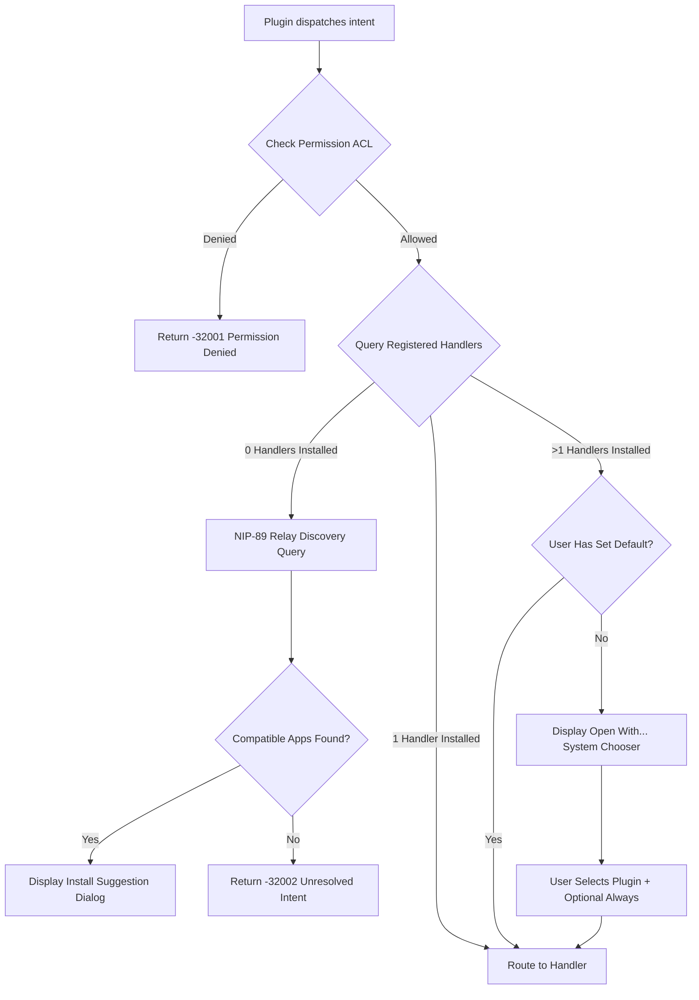

# 06. Intent Protocol Specification

## 1. Overview & Communication Modalities

The **Omni Intent Engine** is a cross-plugin message broker and orchestration layer that enables isolated plugins to interoperate without direct dependencies.

Rather than plugins importing or calling each other directly, they declare capabilities and emit standard semantic **Intents**.

```
+-----------------------------------------------------------------------------------------------+
|                                    Omni Intent Engine                                         |
|                                                                                               |
|  +-----------------------------------------------------------------------------------------+  |
|  |                                  Intent Registry                                        |  |
|  |   - Handler declarations from plugin manifests                                          |  |
|  |   - User default handler preferences (e.g. Default Wallet, Default Media Viewer)        |  |
|  +-----------------------------------------------------------------------------------------+  |
|                                                  |                                            |
|  +-----------------------------------------------+-----------------------------------------+  |
|  |                                Intent Router & Dispatcher                               |  |
|  +-----------------------------------------------------------------------------------------+  |
|         |                                    |                                    |           |
|  (Mode 1: Headless RPC)           (Mode 2: Interactive UI)             (Mode 3: Pub/Sub)      |
|         v                                    v                                    v           |
|  +---------------------+          +----------------------+             +-------------------+  |
|  | 1:1 Request/Reply   |          | Remote DOM Modal/Sheet|            | 1:Many Broadcast  |  |
|  | (Data query/calc)   |          | (Native User Flow)   |             | (Event bus)       |  |
|  +---------------------+          +----------------------+             +-------------------+  |
+-----------------------------------------------------------------------------------------------+
```

---

## 2. The Three Intent Modalities

### 2.1. Modality 1: Headless Data RPC (1:1 Direct)
Used when a plugin needs data or computation from a background service or utility plugin.
* **Flow:** Asynchronous Promise (Request -> Host ACL Check -> Route to Target -> Return Result).
* **Example:**
  ```typescript
  const summary = await omni.intents.dispatch("ai.summarize", {
    text: "Long Nostr article content...",
    maxWords: 50
  });
  ```

### 2.2. Modality 2: Interactive UI Intents (Native Remote DOM Modal / Sheet)
Used when an intent requires user confirmation, visual interaction, or complex input (e.g. Zap payment, media picker).
* **Flow:**
  1. Initiating plugin or native shell dispatches UI intent (e.g. `wallet.send-payment`).
  2. Omni Host opens a native modal or slide-over sheet container.
  3. The target plugin projects its interactive UI component directly into this container using **Shopify Remote DOM**.
  4. The user interacts directly with the projected elements (native buttons, input fields, satoshi slider) with host design system styles and animations.
  5. Target plugin completes the flow and returns the result via `omni.intents.completeUI(result)`.
  6. Omni Host closes the modal and resolves the promise on the caller plugin.
* **Example:**
  ```typescript
  const paymentReceipt = await omni.intents.dispatch("wallet.pay-invoice", {
    invoice: "lnbc210u1p...",
    comment: "Zap note"
  });
  ```

### 2.3. Modality 3: Pub/Sub Event Broadcasts (1:Many)
Used for notifying the system of events without expecting a direct return payload.
* **Flow:** Fire-and-forget message emitted across all plugins granted permission to listen to that event namespace.
* **Example:**
  ```typescript
  omni.intents.emit("media.player.playing", {
    trackTitle: "Nostr Podcast Episode 42",
    duration: 3600,
    author: "hex_pubkey"
  });
  ```

---

## 3. Resolution Flow & System UI Chooser

When an intent is dispatched (`omni.intents.dispatch(action, data)`), Omni follows this resolution lifecycle:



### 3.1. System Chooser ("Open With...")
If multiple plugins declare support for `wallet.pay-invoice` (e.g., Alby Mini-App and Cashu Mini-App), Omni renders a native system dialog allowing the user to select the handler and optionally check *"Always use this plugin for this action"*.

---

## 4. Decentralized NIP-89 Fallback Discovery

If an intent is emitted for which no local plugin is installed (e.g. `nostr.render-kind.30023` for Long-Form Articles):
1. Omni queries Nostr relays for NIP-89 App Handler announcements (`kind: 31989` / `kind: 31990`) advertising support for that specific event kind or intent action.
2. If matching decentralized mini-apps exist, Omni displays an inline recommendation:
   > *"No app installed to view Long-Form Articles. Would you like to install **Habla Reader** or **Highlighter**?"*
3. If approved, Omni downloads the verified manifest, prompts for permissions, installs the plugin, and completes the intent seamlessly.

---

## 5. Standard Intent Namespaces

To foster cross-compatibility across independent plugin developers, Omni defines standardized schemas:

| Namespace | Action | Description | Payload Schema |
| :--- | :--- | :--- | :--- |
| **`wallet.*`** | `wallet.pay-invoice` | Pay a Lightning / Bolt11 / Cashu invoice | `{ invoice: string, amountSats?: number }` |
| | `wallet.create-invoice`| Generate a receive invoice | `{ amountSats: number, description?: string }` |
| **`social.*`** | `social.view-profile` | Open a user's profile view | `{ pubkey: string }` |
| | `social.open-thread` | Open a conversation/note thread | `{ eventId: string, relayHint?: string }` |
| | `social.compose-note` | Open note compose modal | `{ defaultText?: string, replyTo?: string }` |
| **`media.*`** | `media.pick` | Select an image or video | `{ mimeTypes: string[], maxCount?: number }` |
| | `media.play-audio` | Stream audio in global player | `{ url: string, title: string, artist?: string }` |
| **`calendar.*`**| `calendar.create` | Add an event (kind 31922) | `{ title: string, start: number, end?: number }` |
| **`contacts.*`**| `contacts.select` | Open contact picker | `{ multiSelect?: boolean }` |
