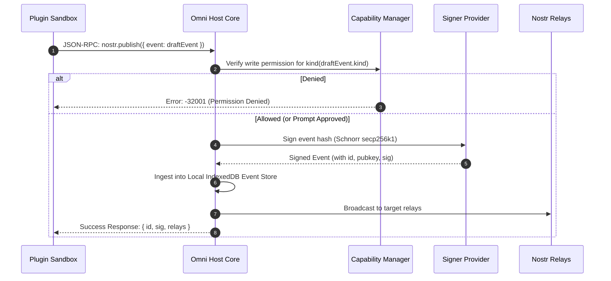

# 07. Key Management & Security Model

## 1. Multi-Tier Signer Architecture

Omni enforces a strict boundary: **plugins never touch private keys directly**. The Omni Host Core manages cryptographic identity and delegates signing requests to one of three user-configured **Signer Providers**:

```
+-----------------------------------------------------------------------------------------------+
|                                      Omni Host Core                                           |
|                                                                                               |
|  +-----------------------------------------------------------------------------------------+  |
|  |                            Host Permission & Policy Guard                               |  |
|  |       (Evaluates Kind ACLs, Auto-approval timers, Rate Limits, and Decryption Scopes)   |  |
|  +-----------------------------------------------------------------------------------------+  |
|                                                  |                                            |
|                                                  v                                            |
|  +-----------------------------------------------------------------------------------------+  |
|  |                             Multi-Tier Signer Provider Abstraction                      |  |
|  +-----------------------------------------------------------------------------------------+  |
|         |                                    |                                    |           |
|  (Tier 1: Local WebCrypto)           (Tier 2: NIP-07 Extension)          (Tier 3: NIP-46 Bunker)
|         v                                    v                                    v           |
|  +-----------------------+          +-------------------------+          +-----------------+  |
|  | Encrypted nsec in IDB |          | window.nostr bridge     |          | Remote Signer   |  |
|  | AES-GCM + PBKDF2      |          | (nos2x, Alby, Amber)    |          | (Nostr Connect  |  |
|  | (Optional WebAuthn)   |          |                         |          |  over Relays)   |  |
|  +-----------------------+          +-------------------------+          +-----------------+  |
+-----------------------------------------------------------------------------------------------+
```

---

## 2. Signer Provider Details

### 2.1. Tier 1: Local Encrypted Keystore (`nsec`)
* **Key Derivation:** Master key derived from user passphrase using **PBKDF2-HMAC-SHA256** (100,000+ iterations) or hardware-backed **WebAuthn PRF**.
* **Storage:** Raw `nsec` is encrypted using **AES-256-GCM** with a unique IV and stored in `omni_kernel_db` IndexedDB.
* **In-Memory Lifetime:** Unencrypted keys reside only in Host Core memory and are scrubbed upon tab closure or inactivity timeout.

### 2.2. Tier 2: NIP-07 Browser Extension
* Interacts with browser extensions (`window.nostr` such as Alby, nos2x).
* Omni proxies signing and decryption requests to the extension, adding an extra layer of granular permission auditing.

### 2.3. Tier 3: NIP-46 Remote Bunker (Nostr Connect)
* Omni connects to a remote hardware bunker (e.g. Amber on Android, nsecBunker, or Keet) over encrypted Nostr relays.
* Omni acts as the NIP-46 client, managing ephemeral bunker session keys.

---

## 3. Cryptographic Operation Pipelines

### 3.1. Signing Pipeline (`nostr.publish` / `nostr.signEvent`)



---

## 4. Encryption & Decryption Security (NIP-04 / NIP-44 / NIP-17)

Decryption of private communications is one of the most sensitive operations in Nostr. Omni prevents rogue plugins from exfiltrating conversations:

### 4.1. Decryption Capability Rules
* Plugins requesting decryption (e.g. Direct Message plugins) must request `nostr:nip44_decrypt` or `nostr:nip04_decrypt` permissions.
* Decryption permissions can be scoped:
  * **Global:** Can decrypt any incoming message addressed to user.
  * **Contact-Scoped:** Can only decrypt messages where the conversation peer is in the user's NIP-02 contact list.
  * **Explicit Session:** Requires user confirmation for new counterparties.

### 4.2. Host-Side Batch Decryption
To ensure fast rendering of chat histories without triggering hundreds of individual modal prompts:
* Omni validates the plugin's batch decryption grant.
* Omni decrypts the encrypted payloads in the Host Core using the active signer and returns the decrypted text array over the secure `MessagePort`.

---

## 5. Auto-Approval Policies & Session Grants

To prevent prompt fatigue while maintaining high security, Omni implements configurable **Permission Policies**:

| Event Type / Action | Default Policy | Auto-Approval Option |
| :--- | :--- | :--- |
| **Kind 1 (Public Notes)** | Prompt on first use | *Auto-approve for 60 minutes* or *Always allow* |
| **Kind 7 (Reactions / Likes)** | Auto-approve | *Always allow for active feed plugin* |
| **Kind 6 (Reposts)** | Auto-approve | *Always allow for active feed plugin* |
| **Kind 0 (Profile Metadata)** | **Always Prompt** | *No auto-approval (High Risk)* |
| **Kind 3 (Contact List)** | **Always Prompt** | *No auto-approval (High Risk)* |
| **Kind 10002 (Relay List)** | **Always Prompt** | *No auto-approval (High Risk)* |
| **Lightning / Zaps (Payments)**| **Always Prompt** | *Configurable Budget (e.g. max 5,000 sats/day)* |
