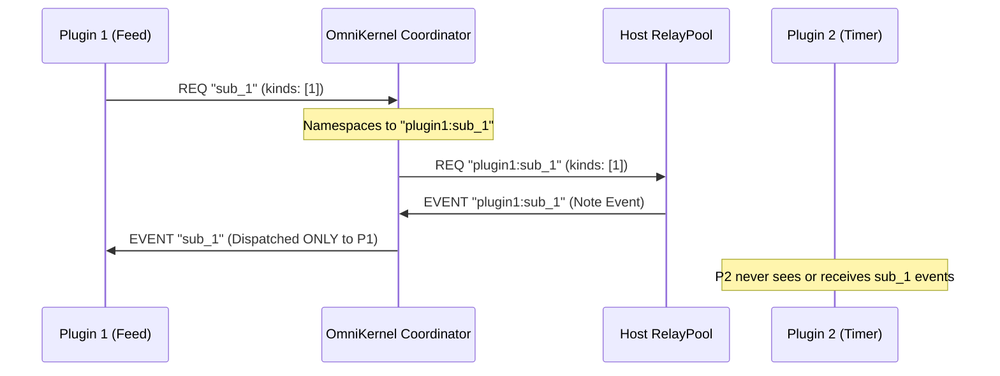
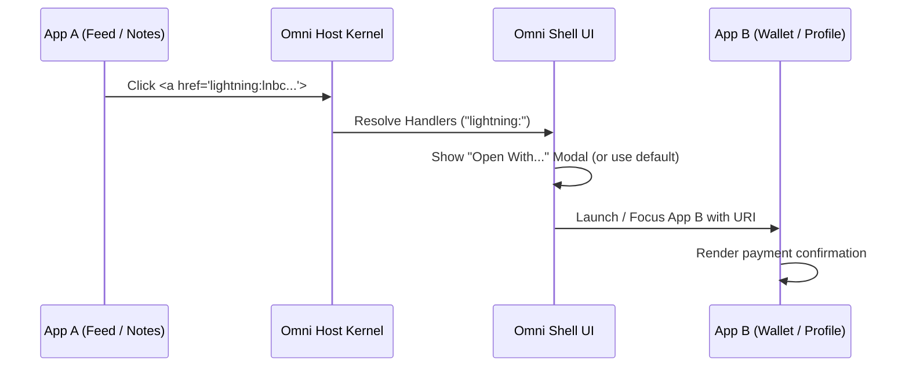
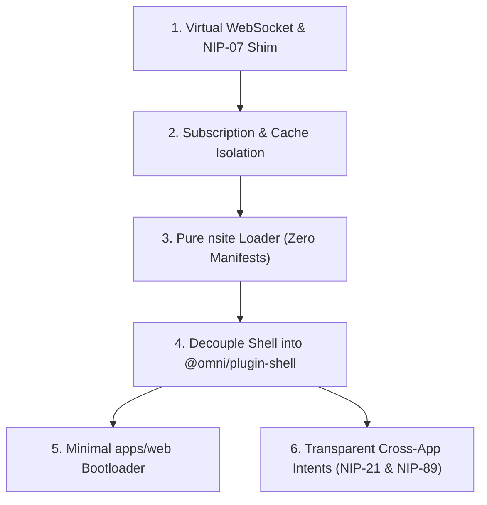

# Omni Architecture Evolution: Pure nsites, Zero Manifests, & Pluggable Shell

> **Status:** Approved Architecture Plan  
> **Target:** Omni v2 Architecture  
> **Authors:** Omni Core Team & Antigravity  

---

## 1. Executive Summary & Core Philosophy

Omni is evolving from a client requiring a proprietary SDK (`window.omni`) and custom manifests (`omni.manifest.json`) into a **pure micro-frontend runtime for 100% standard Nostr sites (nsites)**.

### The Core Pillars
1. **Zero Proprietary SDKs**: Developers write standard web applications using open web & Nostr standards (`window.nostr` / NIP-07, `nostr-tools`, native `WebSocket`, `localStorage`, `indexedDB`, and standard DOM). Omni virtualizes the environment transparently.
2. **Zero Manifests (Everything is an nsite)**: There are no manifest files (`omni.manifest.json`). Every widget, tool, or full application is a standalone, normal NIP-5A nsite (`index.html`) hosted on Blossom. If an author creates a companion widget, it is simply its own standalone nsite.
3. **Slots are Purely User-Defined Viewports**: The concept of a "slot" is completely eliminated from the developer's vocabulary. Slots are purely host layout containers (Full Page, Widget Card, Dock Shortcut) configured visually by the **user**. Any nsite can be placed into any layout container.
4. **Microkernel Shell (`@omni/plugin-shell`)**: The UI frame (header, dock, navigation, settings, layout configurator) is decoupled from `apps/web/index.html` and implemented as a first-class shell plugin. `apps/web` is strictly a ~30-line microkernel bootloader.
5. **Strict Subscription & Data Isolation**: Network subscriptions and cache queries are cryptographically and logically isolated so that data requested by Plugin A can never leak into Plugin B.
6. **Transparent Cross-App Intents**: Replace proprietary intent dispatchers with open web & Nostr standards: standard URI protocol navigation (`nostr:`, `lightning:`, `cashu:`), NIP-89 App Handlers (`kind: 31989`) with an "Open With..." chooser, and standard `navigator.share()`.

---

## 2. Transparent API Virtualization

A plugin developer does not install `@omni/sdk` or reference `window.omni`. They develop a normal web application that runs standalone in any browser or inside Omni.

```
┌─────────────────────────────────────────────────────────────┐
│                       Plugin Sandbox                        │
│                                                             │
│   Standard Web / Nostr Application:                         │
│   • UI: React, Svelte, or Vanilla DOM (document.body)       │
│   • Signer: window.nostr (NIP-07)                           │
│   • Networking: new WebSocket("wss://...") / SimplePool     │
│   • Storage: localStorage / indexedDB                       │
└────────────┬─────────────────────────────┬──────────────────┘
             │ Virtualized WebSocket       │ Remote DOM / Port 1
             ▼                             ▼
┌─────────────────────────────────────────────────────────────┐
│                      Omni Host Kernel                       │
│                                                             │
│   • Subscription Coordinator (Namespaced IPC)               │
│   • RelayPool & LocalEventStore (0ms cache hits)            │
│   • ACL Engine & Keystore (secp256k1 Schnorr signer)        │
│   • LayoutManager (Projects DOM into user-selected view)    │
└─────────────────────────────────────────────────────────────┘
```

### 2.1 Identity & Signing (NIP-07 `window.nostr`)
- Sandboxes are injected with standard `window.nostr`:
  - `getPublicKey(): Promise<string>`
  - `signEvent(draft): Promise<NostrEvent>`
  - `getRelays(): Promise<Record<string, { read: boolean; write: boolean }>>`
  - `nip04.encrypt(pubkey, text)` / `nip04.decrypt(pubkey, cipher)`
  - `nip44.encrypt(pubkey, text)` / `nip44.decrypt(pubkey, cipher)`
- Host keystore signs events after ACL checks.

### 2.2 Transparent Relay Networking (Virtual `window.WebSocket`)
- Untrusted sandboxes run air-gapped (`connect-src 'none'`).
- The sandbox runtime provides a **Virtual `window.WebSocket`**:
  ```javascript
  // Standard Nostr library code inside the plugin sandbox:
  const pool = new SimplePool();
  pool.subscribeMany(relays, [{ kinds: [1], limit: 20 }], {
    onevent(e) { console.log("Received note:", e); }
  });
  ```
- The virtual WebSocket translates standard Nostr relay frames (`REQ`, `EVENT`, `CLOSE`) into host IPC messages, routed through Omni's deduplicated `RelayPool`.
- The plugin developer writes ordinary code that runs seamlessly both inside Omni and standalone in any browser.

### 2.3 Transparent Storage (`localStorage` and `indexedDB`)
- The sandbox iframe isolates storage per origin or scopes keys through a lightweight proxy keyed by `pluginId`.
- Standard `localStorage.getItem()` / `setItem()` and IndexedDB (Dexie, idb) work out of the box.

### 2.4 UI Rendering (Native DOM)
- The plugin simply renders to standard HTML (`document.body.appendChild(...)` or `createRoot(document.getElementById('root'))`).
- The Remote DOM host automatically captures and projects the tree into the user's assigned container.

---

## 3. Data Isolation: Preventing Cross-Plugin Leakage

> [!IMPORTANT]
> **Isolation Mandate:** Data requested by Plugin 1 must never leak into Plugin 2.

### 3.1 Subscription Namespacing
When Plugin 1 and Plugin 2 connect through the virtualized WebSocket, the host kernel isolates their subscription channels:



1. **Tagging & Routing**: The host prepends each subscription ID with the requesting plugin's unique ID (`${pluginId}:${subId}`). When the relay responds with `["EVENT", subId, payload]`, the host strips the prefix and routes the frame **strictly to the originating plugin's IPC port**.
2. **Zero Cross-Talk**: Plugin 2 never receives event streams or notifications for subscriptions opened by Plugin 1.

### 3.2 ACL-Governed Local Cache Filtering
- Because Omni features a shared `LocalEventStore` (0ms IndexedDB cache), plugins querying events locally could theoretically query sensitive notes.
- **Enforcement**: Before returning cached events from a query, the kernel's `AclEngine` filters the result set against the calling plugin's declared permissions:
  - Public notes (`kind: 1`): Allowed if `nostr:read` is granted.
  - Encrypted Direct Messages (`kind: 4`, `kind: 1059`): **Strictly blocked** unless the plugin has explicit, user-confirmed permission for encrypted messaging.
  - A low-privilege widget cannot query the local store to snoop on private chats or custody keys.

### 3.3 Storage Partitioning
- Scoped IndexedDB stores prevent Plugin 1 from inspecting or modifying Plugin 2's local state.

---

## 4. Deconstructing "Slots": From Hardcoded Names to User Viewports

### 4.1 Do Developers Need to Know About "Slots"?
**No.** Developers should never declare, configure, or even know about "slots".

In the new architecture:
- An nsite is just a web app. It has no concept of Omni slots.
- **Slots are purely user-facing visual viewports** provided by the shell:
  1. **Full Page Viewport**: The nsite runs as a primary full-screen page in the main navigation.
  2. **Widget Card Viewport**: The nsite runs as a card in the user's multi-column Widgets dashboard.
  3. **Dock Shortcut**: Pinned item in the navigation dock.

### 4.2 User-Driven Layout Customization
- The **user** decides where each nsite lives:
  - User can place a Feed nsite in a full page, or shrink it into a widget card.
  - User can place a Focus Timer nsite in the widgets dashboard, or open it full screen.
- Nsite developers use standard responsive CSS (media queries or container queries: `@container (max-width: 400px)`) so their app looks great both as a full page and as a widget card.
- "Slot names" (e.g., "Full Page", "Widgets Grid", "Dock") are purely human-friendly visual labels in the Layout Configurator to help the user organize their workspace.

---

## 5. Plugin Packaging: Zero Manifests (Pure Standalone nsites)

### 5.1 Eliminating `omni.manifest.json`
- In Omni v1, each plugin required an `omni.manifest.json` defining components, slots, and quotas.
- In Omni v2, **`omni.manifest.json` is completely eliminated**.

### 5.2 Pure NIP-5A Standalone nsites
- Every widget and application is published as a standard NIP-5A nsite:
  - Event: **`kind: 35129`**
  - Tags:
    - `["d", "<identifier>"]`
    - `["name", "<App Name>"]`
    - `["f", "index.html", "<sha256-hash>", "text/html"]`
    - `["server", "https://cdn.satellite.earth"]`
  - Addressable via standard **`naddr1...`** identifiers.
- **Widgets as Standalone nsites**:
  - If a developer builds a full "Chess Game" and a companion "Chess Widget", they are simply published as **two standalone nsites**:
    - `naddr1...chess-game`
    - `naddr1...chess-widget`
  - Both are 100% standard web apps.
  - The user can install either or both, and assign them to whatever viewport they prefer.

---

## 6. Microkernel Shell Architecture (`@omni/plugin-shell`)

### 6.1 Minimal `apps/web/index.html` Bootloader (~30 lines)
`index.html` contains no hardcoded UI:

```html
<!DOCTYPE html>
<html lang="en">
<head>
  <meta charset="UTF-8">
  <meta name="viewport" content="width=device-width, initial-scale=1.0, maximum-scale=1.0, user-scalable=no, viewport-fit=cover">
  <meta name="theme-color" content="#141312">
  <title>Omni</title>
  <link rel="stylesheet" href="/src/style.css">
</head>
<body>
  <div id="omni-root"></div>
  <script type="module" src="/src/main.ts"></script>
</body>
</html>
```

### 6.2 Host Kernel (`apps/web/src/main.ts`)
`main.ts` does only:
1. Boots `OmniKernel` (keystore, relay pool, capability store).
2. Loads the active Shell Plugin (default: `@omni/plugin-shell`).
3. Passes `#omni-root` to the Shell.

### 6.3 The Shell Plugin (`packages/plugins/shell`)
The Shell Plugin renders and controls:
- The top header (brand, identity badge).
- The navigation dock (page tabs, settings trigger).
- View routing (Page 1: Full Page Viewport, Page 2: Widgets Grid Viewport).
- Settings Modal & Visual Layout Configurator.
- Container elements where sandboxed nsites are projected.

---

## 7. Transparent Cross-App Intents & Protocol Handlers

### 7.1 Why Eliminate `omni.intents`?
In Omni v1, plugins communicated via `window.omni.intents.dispatch("create_note", data)`. This suffered from two fundamental flaws:
1. It tied developers to a proprietary Omni-only API.
2. It bypassed open Nostr standards for cross-application coordination.

In Omni v2, cross-app intents are **100% open web and open Nostr standards**:
- **NIP-21 URI Protocol Schemes**: `nostr:`, `lightning:`, `cashu:`.
- **NIP-89 Application Handlers**: `kind: 31989` (App Handler) and `kind: 31990` (App Recommendation).
- **Web Share API**: Standard `navigator.share({ title, text, url })`.

### 7.2 URI Protocol Interception (NIP-21, Lightning, Cashu)
Nsite developers write standard web links or JavaScript navigations:
```html
<!-- Open a Nostr profile or note -->
<a href="nostr:npub1...">View Profile</a>
<a href="nostr:nevent1...">View Thread</a>

<!-- Pay a Lightning invoice or Cashu token -->
<a href="lightning:lnbc...">Pay 1,000 sats</a>
<a href="cashu:ey...">Claim Ecash</a>
```
Or in JavaScript:
```javascript
window.open("nostr:nprofile1...");
```

1. **Sandbox Interception**:
   The sandbox bridge intercepts link clicks and `window.open()` invocations containing `nostr:`, `lightning:`, and `cashu:` protocol URIs.
2. **IPC Dispatch to Kernel**:
   The URI is forwarded to the host kernel via Port 2 RPC (`kernel.handleUri({ uri, sourcePluginId })`).

### 7.3 NIP-89 App Handler Discovery & Resolution
When an intent URI is received, the host resolves capable handlers:
1. **Installed Handlers**: The host checks installed nsites whose metadata or NIP-89 `kind: 31989` tag specifies support for the target protocol or event kind (e.g., `["k", "1"]` for notes, `["k", "0"]` for profiles, `["k", "30023"]` for long-form articles).
2. **Decentralized Relay Discovery**: If no local handler exists, the host queries relays for known NIP-89 handlers (`kind: 31989`) and user recommendations (`kind: 31990`).

### 7.4 "Open With..." System Chooser
When multiple apps can handle the URI:
1. **System Chooser Dialog**: The host shell presents a clean modal listing available apps with their icons and names.
2. **Default Preference ("Always Use This App")**: Users can check "Always open with this app" to remember their preference in local capabilities storage.
3. **App Invocation**: The chosen nsite is focused (or opened in the active viewport), and the URI is passed cleanly (via query param `?uri=...` or standard `window.onhashchange`).



### 7.5 Web Share API Shim (`navigator.share`)
Sandboxed nsites can invoke standard Web Share:
```javascript
await navigator.share({
  title: "Check out this article",
  url: "https://example.com"
});
```
- In the sandbox bridge, `navigator.share()` is shimmed to route the payload to the host.
- The host opens the active Composer or delegates to the user's preferred note-sharing nsite, pre-populating the draft.

---

## 8. Step-by-Step Implementation Roadmap



### Milestone Checklist

- [ ] **Milestone 1: Virtual WebSocket & NIP-07 Shim**
  - Implement Virtual `window.WebSocket` class in `apps/web/public/omni-runtime.js` and `default-runtime.ts`.
  - Connect Virtual WebSocket `send()` to kernel RPC methods (`nostr.subscribe`, `nostr.publish`).
  - Implement standard NIP-07 `window.nostr` (`getPublicKey`, `signEvent`, `getRelays`, `nip04`, `nip44`).
  - Support `document.body` auto-mount into Remote DOM root.

- [ ] **Milestone 2: Subscription & Cache Isolation**
  - Add subscription namespacing (`${pluginId}:${subId}`) in `SubscriptionCoordinator` and `RelayPool`.
  - Enforce ACL filtering on local cache queries (prevent unpermitted DMs/Kind-4 snooping).
  - Scope IndexedDB and localStorage keys per `pluginId`.

- [ ] **Milestone 3: Pure nsite Loader (Zero Manifests)**
  - Update `NostrPluginResolver` to resolve any NIP-5A `kind: 35129` event by reading `["f", "index.html", ...]`.
  - Remove mandatory `omni.manifest.json` parsing.
  - Automatically derive app name, description, and author from standard NIP-5A tags (`name`, `description`, `d`, author pubkey).

- [ ] **Milestone 4: Decouple Shell into `@omni/plugin-shell`**
  - Create package `packages/plugins/shell/`.
  - Move the header, dock, view switcher, Settings modal, and Visual Layout Configurator into the shell plugin.
  - Provide layout viewports (Full Page, Widgets Grid, Dock shortcuts) that can host any nsite.

- [ ] **Milestone 5: Minimal `apps/web` Bootloader**
  - Strip hardcoded layout markup from `apps/web/index.html` down to `<div id="omni-root"></div>`.
  - Wire `apps/web/src/main.ts` to boot kernel, mount `@omni/plugin-shell`, and pass control.
  - Verify all existing core tests and integration tests pass cleanly.

- [ ] **Milestone 6: Transparent Cross-App Intents (NIP-21, NIP-89 & Web Share)**
  - Intercept `nostr:`, `lightning:`, and `cashu:` protocol navigations in the sandbox bridge.
  - Implement NIP-89 handler lookup (`kind: 31989/31990`) in kernel and shell.
  - Build the "Open With..." system chooser modal in `@omni/plugin-shell` with "Always use this app" persistence.
  - Shim `navigator.share()` to route note drafts directly into the host composer or preferred sharing nsite.
