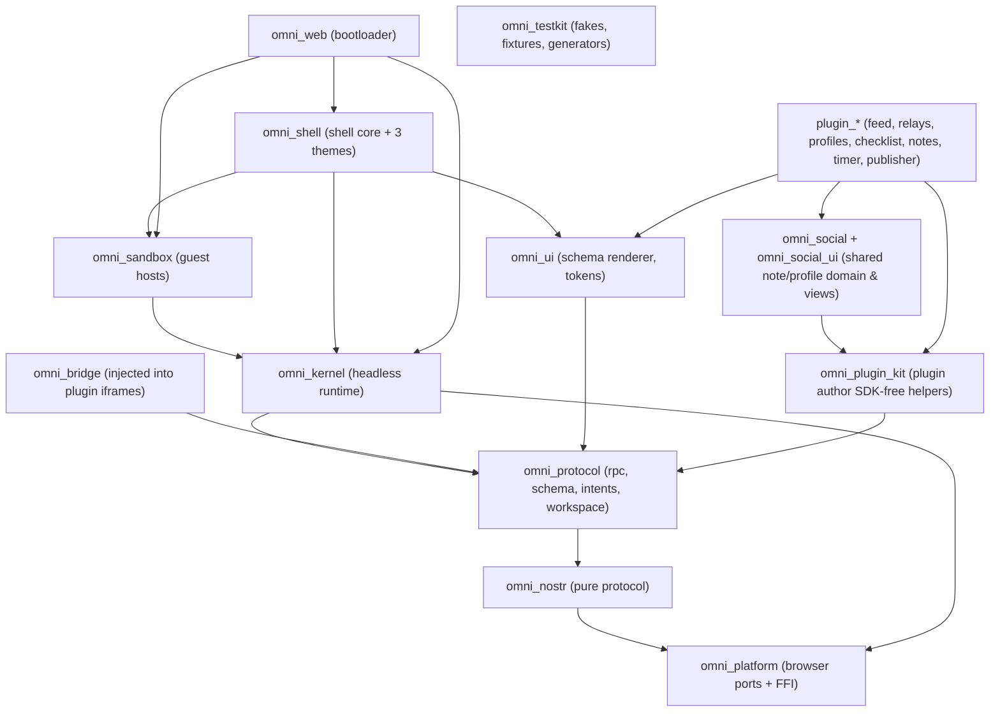
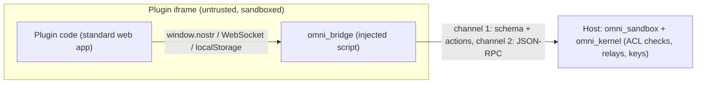
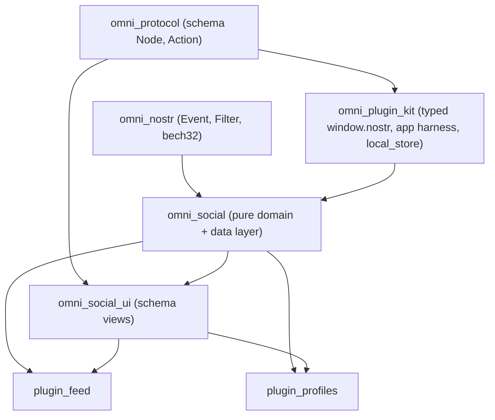

# Omni → Gleam: Rewrite Plan

> Target: Gleam (installed: 1.19.2) compiled to **JavaScript**. Goals: clean code, maintainability, correctness. This is a *redesign in Gleam*, not a line-by-line port.

> [!NOTE]
> The context7 MCP isn't exposed as a tool in this session. I used the [Gleam externals guide](https://gleam.run/documentation/externals/) and a survey of the repo. **Every package name and version below (lustre, plinth, gleam_json, etc.) must be verified in Phase 0** before we rely on it.

---

## 1. Current Codebase (what we're replacing)

| Area | Size | Notes |
|---|---|---|
| `packages/core` | ~13.9k LOC | Biggest files: `primitive-elements.ts` (2.1k), `omni-runtime.js` (1.7k, sandbox bridge), `sandbox-manager.ts` (1.4k), `omni-kernel.ts` (1.3k), `json-rpc-dispatcher.ts` (1.1k), `wasm-guest-host.ts` (1k) |
| `plugins/shell` | ~15.9k LOC | Three shells of 2.4–2.7k LOC each (`base`, `panorama`, `editorial`) plus 5.6k LOC of CSS-in-TS strings |
| Other plugins | ~7k LOC | publisher 2.5k, profile-viewer 2k, notes 1.2k, checklist, relays, timer |
| `packages/types` | 1.3k LOC | Includes a hand-written bech32 |
| MoonBit feed | 1.7k LOC | Compiles to Wasm and uses WIT |
| Tests | ~10.7k LOC | 264 tests, vitest + happy-dom |

**Smells to fix, not port**
- God classes: `OmniKernel`, `SandboxManager`, `BaseShell`.
- The shells are 3 near-duplicate 2.5k-line files linked by inheritance.
- `details?: any`, string capability categories (`"nostr:sign"`), and string-switch RPC dispatch.
- CSS lives inside TS template strings.
- Duplicated `bech32.ts` re-exports in 3 plugins.
- The sandbox bridge (`omni-runtime.js`) is untyped JS.

---

## 2. Principles

1. **Functional core, imperative shell.** All decisions (ACL, routing, merging, layout, reducers) are pure functions. Browser I/O sits behind narrow *ports*.
2. **Parse, don't validate.** Every untrusted JSON (RPC, relay frames, `postMessage`, localStorage, Nostr events) is decoded **once** at the boundary into precise types. After that there are no `Dynamic`, no stringly-typed data.
3. **Make illegal states unrepresentable.** Use custom types (ADTs) and opaque types with smart constructors (`PluginId`, `EventId`, `Pubkey`, `RelayUrl`, `Capability`).
4. **Effects as data where it pays off.** `update(state, msg) -> #(state, List(Effect))`, with a small interpreter in the shell layer. Use this for the kernel's stateful logic (ACL prompts, relay pool, subscriptions). It is trivially testable.
5. **FFI is a quarantined adapter layer.** The FFI rules are in §4.
6. **Composition over inheritance.** Shell variants (Classic, Panorama, Editorial) share one `Model`/`update` and differ only by a `ShellTheme` strategy and view functions.
7. **One-way dependency graph, enforced by package boundaries.** See §3.
8. **No hardcoded plugin IDs anywhere.** This is a CI-enforced rule (grep check), matching AGENTS.md.

---

## 3. Package Structure

Gleam has no native workspaces. Each package is its own Gleam project, linked with `path` dependencies in `gleam.toml`. pnpm remains only for npm deps (`@noble/*`, `fflate`, Vite) and the web bundling.



**Rule:** arrows only point down or left. `omni_kernel` must never import `omni_ui`, and `omni_shell` must never be imported by anything but `omni_web`. Gleam's lack of circular imports enforces this per package.

#### Naming convention (resolves review comment on "omni in every folder")

Folder names inside the repo do **not** carry the prefix, because the repo is already `omni/`. This mirrors today's `packages/core` and `packages/types`. The prefix lives only in the **`name` field of `gleam.toml`** and in the module namespace:

| Layer | Convention | Example |
|---|---|---|
| Directory | short, no prefix | `gleam/kernel/` |
| `gleam.toml` `name` | `omni_<dir>`, snake_case | `name = "omni_kernel"` |
| Module namespace | `omni/<dir>/...` | `import omni/kernel/acl/policy` |
| Plugin packages | `plugin_<name>` | `plugin_feed`, module root `plugin/feed/...` |

Why keep the prefix on the *package name* and *module path*:
- **Gleam's module namespace is global** across all packages in a build. Two packages can't both define `ui/render`, and a generic package named `ui`, `shell` or `kernel` risks colliding with a Hex dependency (or one added later). A shared prefix namespace is how the official family does it: the `gleam_stdlib`, `gleam_json` and `gleam_javascript` packages all expose `gleam/...` modules.
- The folder prefix would add nothing, so we drop it.
- The package name is independent of the directory name, so this works.

> [!NOTE]
> Single-package projects usually name the root module after the package (`lustre` → `lustre/...`). A multi-package family sharing one namespace (the `gleam/` precedent) is the better fit here. Phase 0 verifies the compiler has no constraint against this layout.

```
omni/
├── gleam/                         # all Gleam packages (path-linked). Lives beside the old TS `packages/` during migration (avoids name clashes like plugins/); at the end the TS tree is deleted and `gleam/` may be renamed to `packages/`
│   ├── platform/                  # omni_platform: ports + FFI
│   ├── nostr/                     # omni_nostr: pure protocol
│   ├── protocol/                  # omni_protocol: rpc/schema/workspace contracts
│   ├── kernel/                    # omni_kernel
│   ├── sandbox/                   # omni_sandbox
│   ├── bridge/                    # omni_bridge: script injected INTO plugin sandboxes (§3.6)
│   ├── ui/                        # omni_ui: schema renderer, tokens
│   ├── plugin_kit/                # omni_plugin_kit: typed bindings for plugin authors
│   ├── social/                    # omni_social: shared note/profile domain + data layer (§3.10)
│   ├── social_ui/                 # omni_social_ui: shared note/profile schema views (§3.10)
│   ├── shell/                     # omni_shell
│   ├── web/                       # omni_web: bootloader app
│   ├── testkit/                   # omni_testkit
│   └── plugins/{feed,relays,profiles,checklist,notes,timer,publisher}/   # plugin_<name>
├── assets/styles/                 # real .css files (classic, panorama, editorial, schema, tokens)
├── scripts/                       # build.mjs: builds Gleam packages in dependency order, then Vite
├── docs/                          # updated architecture docs
└── pnpm-workspace.yaml            # npm deps + vite only
```

### 3.1 `omni_platform`: ports and the only FFI

This is a small typed façade over browser APIs. Every other package depends on its *types and functions*, never on raw `.mjs`.

**One small FFI file per Gleam module, co-located, named `<module>.ffi.mjs`** (resolves the "single vs multiple" question).

Evidence from the ecosystem: Lustre uses ~15 small co-located files (`vdom/reconciler.ffi.mjs`, `internals/ref.ffi.mjs`, `runtime/client/spa.ffi.mjs`, ...), whereas `gleam_stdlib` uses one big `gleam_stdlib.mjs`. The stdlib's single file is a historical exception, shared by dozens of modules. The externals guide itself says to design each external API for Gleam, and says external code can't be checked by the compiler or LSP. Several reasons point to small per-module files for us:
- **Locality.** The `@external` path is relative (`"./idb.ffi.mjs"`), so the Gleam signature and its JS body are always one hop apart. Review and refactoring touch one pair of files.
- **Small blast radius.** An FFI file only imports what that port needs (e.g. only `idb.ffi.mjs` knows IndexedDB, only `secp256k1.ffi.mjs` imports `@noble/curves`). Bundlers tree-shake per module, and the sandbox guest bundle doesn't pull in crypto it doesn't use.
- **Testability.** Each port is tested in isolation with a fake global (happy-dom or stubs).
- **No grab-bag file.** A single `ffi.mjs` becomes an unowned utility file, the exact smell we're cleaning up.

Rules:
1. Only `platform/` (and `bridge/`, §3.6) may contain `.mjs` or `@external`. The lint script allows these two paths only.
2. A `.ffi.mjs` file never imports another `.ffi.mjs`. Shared JS helpers go through a Gleam module instead.
3. Prefer plain JS values across the boundary (strings, numbers, booleans, arrays, plain objects, `undefined`/`null`). Convert to Gleam `Result`/`Option` in **Gleam** by decoding, so the `.mjs` files don't depend on Gleam's internal class layout (`Ok`, `Error`, `List`). Where an `.mjs` must construct Gleam values, import them from the generated prelude (the guide documents the constructor API since v1.13).
4. Every function that can throw returns a tagged result or catches inside the `.mjs`. Nothing throws into Gleam code.

```
gleam/platform/src/omni/platform/
  promise_ext.gleam            # helpers on gleam_javascript Promise (try_await, all, timeout)
  ref.gleam / ref.ffi.mjs      # opaque mutable Ref(a): the one place we allow mutation
  storage.gleam / storage.ffi.mjs     # localStorage port + in-memory fake
  idb.gleam / idb.ffi.mjs             # IndexedDB: open, get, put, query by index → Promise(Result)
  websocket.gleam / websocket.ffi.mjs # opaque Socket + typed events (Open/Message/Close/Error)
  message_port.gleam / .ffi.mjs       # MessageChannel / postMessage with Dynamic payload
  webcrypto.gleam / .ffi.mjs          # sha256, random bytes, AES-GCM
  secp256k1.gleam / .ffi.mjs          # wraps @noble/curves: sign, verify, pubkey derivation
  nip44.gleam / .ffi.mjs              # wraps @noble/ciphers + hashes; nip04
  zip.gleam / .ffi.mjs                # wraps fflate
  url.gleam, clock.gleam (+ .ffi.mjs) # URL parsing, now(), timers (injectable for tests)
  json.gleam / json.ffi.mjs           # JSON.parse/stringify ↔ gleam_json bridging
  dom.gleam                           # thin re-export/wrap of plinth where it exists (D4); .ffi.mjs only for gaps
```

- **plinth first (D4 agreed).** Use `plinth` for DOM, `window`, storage and similar browser APIs wherever it covers them. Wrap it inside `platform/` so the rest of the code never imports it directly, and we can swap it out. Only gaps get our own `.ffi.mjs`.
- Each port exposes a **record of functions**, e.g. `pub type Storage { Storage(get: fn(String) -> Option(String), set: ..., remove: ...) }`. Production uses the browser implementation, and tests pass `storage.in_memory()`.
- External types are narrowly scoped (`ZipHandle`-style, per the externals guide), never a catch-all `JsObject`.
- Crypto stays on audited npm libraries (`@noble/*`). Do not reimplement it in Gleam.

### 3.2 `omni_nostr`: pure Nostr protocol

```
src/omni/nostr/
  kind.gleam          # pub type Kind { Metadata, Note, ... , Other(Int) } + to_int/from_int; sensitive_kinds()
  pubkey.gleam        # opaque Pubkey (32-byte hex) + parse
  event_id.gleam      # opaque EventId
  event.gleam         # Event, UnsignedEvent, tag helpers, d_tag, serialise for id
  event_codec.gleam   # decoder/encoder (gleam/json + dynamic decode)
  filter.gleam        # Filter type, matches(event, filter), merge, builder API
  bech32.gleam        # pure Gleam bech32/bech32m (replaces TS + MoonBit duplicates)
  nip19.gleam         # npub/nsec/note/nprofile/nevent/naddr encode/decode
  relay_frame.gleam   # ClientFrame / RelayFrame ADTs with codec (REQ/EVENT/CLOSE/EOSE/OK/NOTICE/AUTH)
  relay_url.gleam     # opaque RelayUrl + normalisation
  replaceable.gleam   # replaceable / addressable selection rules (which event wins)
  nip05.gleam, nip65.gleam  # small helpers
```

Bech32, filters, and replaceable-event rules are pure and are the best candidates for property tests.

### 3.3 `omni_protocol`: shared contracts (replaces `@omni/types`)

```
src/omni/protocol/
  plugin_id.gleam
  capability.gleam      # pub type Capability { NostrRead(Kind) | NostrWrite(Kind) | NostrSign(Kind) | NostrEncrypt | Storage | Network(RelayUrl) ... }
  grant.gleam           # pub type Grant { Always | Session | Deny } (+ Prompt outcome)
  rpc/
    envelope.gleam      # JSON-RPC 2.0 request/response/notification + error codes (typed enum)
    method.gleam        # pub type Request { NostrFetch(..) | NostrPublish(..) | SignEvent(..) | StorageGet(..) ... }
    decode.gleam        # raw JSON → Result(Request, RpcError): the single decode point
    encode.gleam
  schema/
    node.gleam          # pub type Node { Box(..) | Card(..) | Button(..) | ... } closed ADT (no strings)
    style.gleam         # typed style tokens instead of free-form css strings
    action.gleam        # Action + Navigate
    codec.gleam         # wire JSON ↔ Node (the postMessage "omni:schema" contract)
    builder.gleam       # ergonomic constructors for plugin authors
  workspace.gleam       # WorkspaceState (NIP-78 d="omni/workspace/v1"), viewport assignments + codec + versioned migrations
  viewport.gleam        # Main | Dock | Sidebar | HeaderActions
  intent.gleam          # Intent, IntentHandler, resolution result
  manifest.gleam        # nsite discovery: view tags, <link rel=alternate>, web manifest shortcuts
  blossom.gleam         # Blossom types (BUD auth event construction)
  wit.gleam             # types mirroring omni.wit for Wasm guests
```

### 3.4 `omni_kernel`: headless runtime

Replaces the 1.3k-line `OmniKernel` with a composition root plus small services. There are no UI, slot or page concepts here.

```
src/omni/kernel/
  kernel.gleam            # composition root: builds services from Ports, returns Kernel record
  ports.gleam             # pub type Ports { Ports(storage, idb, ws_factory, clock, crypto, prompt) }
  acl/
    policy.gleam          # PURE: decide(request, grants, reserved_rules) -> Decision(Allow|Deny|NeedsPrompt)
    reserved.gleam        # the NIP-78 "omni/" d-tag tamper defence as a named rule
    capability_store.gleam# grants persistence (opaque, uses Storage port)
    engine.gleam          # orchestrates policy + prompt effect; the only async piece
    read_filter.gleam     # canReadEvent / sensitive-kind rules (pure)
  nostr/
    event_store.gleam     # LocalEventStore on idb port; query engine over Filter
    event_store_index.gleam # pure indexing/matching
    relay_pool.gleam      # state machine per relay (Connecting|Open|Backoff|Closed) with update/effects
    subscription.gleam    # namespaced SubId(PluginId, local_id); routing table (pure)
    coordinator.gleam     # fetch/subscribe/publish across store + pool, dedupe, sort
    docs.gleam            # nostr.doc reactive docs: optimistic mutations, encryption wrapper
  rpc/
    dispatcher.gleam      # exhaustive `case request` → handler; each handler in handlers/
    handlers/{nostr,signer,storage,intents,navigation,share}.gleam
    rate_limit.gleam      # token bucket (pure + clock)
    quota.gleam
  crypto/
    keystore.gleam        # WebCrypto-backed key custody API (opaque SecretKey)
  plugins/
    resolver.gleam        # NIP-5A nsite / Blossom / naddr resolution as a pipeline of Resolver strategies
    bundler.gleam         # zip bundle reading (uses zip port)
    registry.gleam        # installed plugins, enable/disable
    updates.gleam         # version compare & update detection (pure)
  storage/plugin_storage.gleam  # per-plugin partitioning
  navigation/
    history.gleam         # pure Page stack/history model
    router.gleam          # URL ↔ Page (query-string ?view=…) pure
  intents/broker.gleam    # discovery/resolution (pure matching + prompt effect)
  workspace/sync.gleam    # NIP-78 sync: merge(local, remote) pure, effects for publish
  layout/layout.gleam     # slot assignment model (pure). No DOM reparenting here
```

Notes:
- The `kernel/layout` module should hold only the **data model** of assignments. AGENTS.md puts `LayoutManager` in core, but its DOM reparenting belongs in `omni_shell`. Splitting it also gives a cleaner kernel/shell boundary.
- Each stateful service is `State + Msg + update + Effect`, run by a tiny loop (§5.2).

### 3.5 `omni_sandbox`: guest hosting (host side)

```
src/omni/sandbox/
  host.gleam            # pub type GuestHost { GuestHost(start, send, stop, kind) }: one interface
  iframe_host.gleam     # IframeAppHost
  worker_host.gleam     # WorkerGuestHost
  wasm_host.gleam       # WasmGuestHost (loads any WIT component; language-agnostic)
  channel.gleam         # dual-channel IPC: schema bus (port1) + JSON-RPC bus (port2)
  csp.gleam             # sandbox attribute + CSP builder (typed policy → string)
  tokens.gleam          # design-token injection
  protocol_shims.gleam  # nostr: / lightning: / cashu: link interception; share shim
  css_scoper.gleam      # scope plugin CSS
  manager.gleam         # lifecycle (spawn/kill/reparent-safe handles); thin: delegates to hosts
```

`sandbox-manager.ts` (1.4k LOC) becomes ~8 small modules behind the one `GuestHost` interface (**Strategy** pattern: iframe, worker, and wasm are interchangeable).

### 3.6 `omni_bridge`: the sandbox bridge (replaces `omni-runtime.js`; formerly "sandbox bridge")

**What it is.** Every plugin runs inside a sandboxed `<iframe>` (or Worker) whose CSP blocks the network (`connect-src 'none'`), and the plugin is a plain web app that just calls `window.nostr`, `new WebSocket("wss://...")`, `localStorage`, and so on. Those calls can't work inside a locked-down iframe on their own. So the host injects a small script, today [`omni-runtime.js`](file:///home/spiralnights/code/omni/packages/core/src/sandbox/omni-runtime.js) (1.7k lines), into the iframe *before* the plugin's own code (see `sandbox-manager.ts`, "Build srcdoc injecting omni-runtime.js + plugin script"). It installs shims that **forward those standard APIs over `MessagePort`s to the kernel**:



It is the reason plugins need zero proprietary SDK. I called it "sandbox bridge" because it's code that runs in the *guest* (plugin) side, as opposed to the *host* side (`omni_sandbox`, `omni_kernel`). **`omni_bridge` is a clearer name**, and it is what I'll use from now on.

Shims it provides: NIP-07 `window.nostr` (+ `fetch`/`subscribe`/`publish`/`doc`), virtual `WebSocket`, partitioned `localStorage`/`indexedDB`, scroll API forwarding, `nostr:`/`lightning:`/`cashu:` link interception, `navigator.share`, and the schema `postMessage` bridge.

Compiled Gleam, bundled by esbuild/Vite into **one IIFE string** that the host injects.
```
gleam/bridge/src/omni/bridge/
  main.gleam                 # entry: wires shims inside the sandbox realm
  nostr_shim.gleam           # window.nostr
  websocket_shim.gleam       # virtual WebSocket → RPC
  storage_shim.gleam         # partitioned localStorage / indexedDB facade
  links_shim.gleam, share_shim.gleam, schema_bridge.gleam
  globals.gleam / globals.ffi.mjs   # installs shims on window (monkey-patching = unavoidably FFI)
```
- It runs in an untrusted realm. It stays tiny, never imports `omni_kernel`, and is bundled with dead-code elimination.
- It shares `omni_protocol` codecs with the host, which removes the current risk of host/guest wire-format drift.
- **Trade-off (why D5 is still a real question).** Much of this file is global monkey-patching, which is low in business logic, so Gleam's benefit is smaller than in the kernel. The wire-format sharing is the main win. Because this code is security-sensitive, it is the **last** thing to port (Phase 7), with the old and new bridge run side by side before cutover.

### 3.7 `omni_ui`: schema renderer, design tokens

```
src/omni/ui/
  render.gleam          # pure: Node -> lustre Element(Action): one function per Node variant (replaces 2.1k-line primitive-elements.ts)
  render/{layout,text,input,feedback,list}.gleam
  virtual_list.gleam
  icons.gleam           # typed Icon variant + monochrome SVG line-icon table (no emoji)
  tokens.gleam          # --omni-* token names as constants
  sanitize.gleam        # HTML/style sanitising for plugin-provided content
  host.gleam            # mounts a rendered schema; maps Action → omni:action back to guest
```
- **Decision D1** (§9): Light DOM custom elements (`<omni-box>`...) versus plain Lustre elements. Today plugin CSS and the shells may rely on those tag names. The plan: render **plain elements with stable `omni-*` class names**. Lustre elements are cleaner and testable as pure data. Custom-element tag selectors move to class selectors in the new CSS.

### 3.8 `omni_plugin_kit`: helpers for first-party plugin authors

This is not a proprietary SDK. Plugins stay standard web apps that speak `window.nostr`, `postMessage` and `localStorage`. This kit is just *typed Gleam bindings to those standard APIs* plus builders.
```
src/omni/plugin_kit/
  nostr.gleam           # typed window.nostr (get_public_key, sign_event, fetch, subscribe, publish, doc)
  app.gleam             # Elm-style harness: init/update/view, runs Schema via postMessage OR mounts Lustre
  schema.gleam          # re-export builders
  route.gleam           # window.location.search view routing
  local_store.gleam     # typed localStorage JSON store with versioned decoders
```
AGENTS.md forbids `omni.*` references in plugins. The kit only binds standard APIs, so it complies. A CI grep (`omni\.`) guards that.

### 3.9 `omni_shell`: shell core + three themes

Replaces ~16k LOC, of which ~5.6k is CSS strings.
```
src/omni/shell/
  shell.gleam           # Elm app: Model, Msg, update (shared by all themes)
  model.gleam           # Page, ActivePlugins, Settings, Widgets, ViewportAssignments
  msg.gleam
  update.gleam          # pure; effects = kernel calls, workspace publish
  theme.gleam           # pub type Theme { Theme(id, name, stylesheet, chrome: fn(Model)->Element, ...)}  <- Strategy
  themes/{classic,panorama,editorial}.gleam   # view functions only, ~300-600 LOC each
  registry.gleam        # ShellRegistry: register/select themes (no hardcoded plugin ids)
  layout/
    viewport_host.gleam # reparenting islands: iframe nodes held outside vdom (see §6)
    dock.gleam, header_actions.gleam, widgets_grid.gleam, main_view.gleam
  settings/
    tabs.gleam, placements.gleam, permissions.gleam, intents.gleam, relay_scoping.gleam, shells.gleam
  app_store.gleam       # catalog
  update_modal.gleam
  gestures/pull_to_refresh.gleam
  styles.gleam          # loads assets/styles/*.css as raw strings at build time
```

### 3.10 Plugins and the shared `omni_social` library

Each plugin is a standard nsite built from a Gleam package (JS output bundled to `dist/`), with standard HTML and `<link rel="alternate">` view declarations.
```
gleam/plugins/<name>/        # gleam.toml: name = "plugin_<name>"
  gleam.toml
  src/plugin/<name>/{main,model,msg,update,view,codec}.gleam   # Elm shape
  src/plugin/<name>/net/…, state/…    # as needed
  test/…
  index.html, build config
```

#### Finding: feed and profiles already duplicate code

I compared `profile-viewer` and the feed plugin. Both implement, independently:
- a **note card** (`renderSchemaNoteCard` in [profile-schema.ts](file:///home/spiralnights/code/omni/packages/plugins/profile-viewer/src/schema/profile-schema.ts#L122-L245) vs `render_note_card`/`render_note_actions`/`render_author_header` in [feed.mbt](file:///home/spiralnights/code/omni/packages/plugins/feed/feed.mbt#L659-L705)), with the same like/repost/zap/reply actions
- **note stats** (likes, replies, reposts, zaps, liked/reposted flags)
- kind-1 / kind-0 / kind-3 subscriptions (`{ kinds: [1], authors: [pk], limit: 20 }` appears in both) and kind-0 profile-name resolution
- bech32 / npub truncation (each plugin has its own bech32 re-export)

So yes, there is a real opportunity. It also exposes a design flaw: the profile viewer is re-implementing a mini-feed. Two mechanisms fix it, and they fit the "plugins are separate" tenet differently.

**1. Share code, not runtime: shared libraries are *statically linked* into each plugin at build time.**
The tenet says plugins are autonomous: separately installable, no cross-plugin runtime dependency, standard nsites. A shared *Gleam library* does not break it. The library is compiled into each plugin's own bundle, like any npm dependency, so `plugin_feed` and `plugin_profiles` each ship self-contained `dist/` folders. No plugin imports another plugin, none needs the other installed, and the shell knows nothing about the library. What would break the tenet is a shared *runtime service* or a plugin that imports another plugin's code. We won't do either.

**2. Share behavior through intents, not copies.**
When a user taps a note in a profile, the profile plugin shouldn't implement thread view. It should emit the standard Omni intent / `nostr:` link (`view-note`, handled by `intents/broker`), and whichever installed plugin handles it (the feed, or any other reader the user picked) opens the thread. That deletes the profile plugin's thread/like/repost handling and keeps the plugins decoupled. If no handler is installed, the profile plugin just renders the card read-only.

**The shared packages** (new layering between `plugin_kit` and the plugins):



| Package | Contents | Pure? |
|---|---|---|
| `omni_social` | `Note`, `Profile`, `NoteStats`, `Follows` types and codecs from events; `thread.build(notes)` (reply/root resolution, `resolve_reply_metadata`), `stats.apply(event)` reducer for kinds 6/7/9735, `profile_cache` (versioned local store), `display_name`/`truncate_npub`; `queries.gleam` (named filters: `notes_by_author`, `replies_to`, `profile_for`) | Domain pure; data layer uses `plugin_kit.nostr` |
| `omni_social_ui` | Schema builders: `note_card`, `note_actions`, `author_header`, `reply_badge`, `empty_state`, with `NoteCardConfig` (e.g. `interactive: Bool`, `on_open: Action`) so feed vs. profile can differ without forking | Pure (`Note → schema Node`) |
| `omni_plugin_kit` | Stays generic (typed `window.nostr`, harness, route, `local_store`). **Does not** know about notes | |

Why two packages and not one: `omni_social_ui` depends on the schema AST. A plugin that only needs the data model (e.g. a future search or notifications plugin) shouldn't pull in views. Why not fold it into `plugin_kit`: kit is about *talking to the platform*; social is *Nostr product domain*. Keeping them separate prevents `plugin_kit` from becoming a grab-bag.

**Other shared modules this surfaced** (candidates beyond notes/profiles):
- `omni_nostr.nip19` and `bech32`: replaces the 3+ per-plugin `crypto/bech32.ts` re-exports.
- A **plugin-side relay-subscription helper** in `plugin_kit` (`nostr.subscribe` with auto-unique sub IDs and EOSE handling). Today profile-viewer hand-rolls `["REQ", "pv_schema_..." + Date.now(), ...]` over a raw WebSocket in several places; the feed uses events. Standardize on `nostr.subscribe`.
- `omni_ui.sanitize` (notes plugin, feed content rendering) and `omni_ui.icons`.
- `plugin_kit.local_store`: the versioned-localStorage cache that `profile-store.ts`, `publisher-store.ts` and others each reimplement.
- Candidate for later, not now: `omni_social` content parsing (mentions, `nostr:` URIs, links, hashtags) once a second plugin needs rich note bodies. Don't generalize before there is a second consumer.

**Guardrails** (so sharing doesn't erode autonomy): `omni_social*` may depend only on `omni_nostr`, `omni_protocol`, `omni_plugin_kit`, `omni_ui`; it never references a plugin ID or shell concept; CI forbids `plugin_*` → `plugin_*` imports (lint script).

| Plugin | Notes |
|---|---|
| `feed` | Replaces **MoonBit**. Gleam→JS, Schema UI. Built on `omni_social` + `omni_social_ui`. The MoonBit version moves to `external-plugins/` as an example (D2 agreed). |
| `relays` | Relay status/pool manager. Small. |
| `profiles` | Merges `profile-viewer` store / relay-sync / schema / action-handler into one Msg/update. Uses `omni_social` + `omni_social_ui`; opens threads via the intent, not its own implementation. |
| `checklist`, `timer`, `notes` | Small. Notes sanitiser → `omni_ui.sanitize`; encryption via `nostr.doc({encrypted})`. |
| `publisher` | Zip engine and Blossom uploader are pure + ports; SHA256 via webcrypto port. |

### 3.11 `omni_web` and `omni_testkit`
- `omni_web/src/omni_web.gleam`: ~30 lines. It builds `Ports`, creates the kernel, creates the shell, and mounts it in `#omni-root`. `index.html` stays a minimal skeleton.
- `omni_testkit`: fake `Ports` (in-memory storage, idb, scripted websocket, fake clock, auto-answering prompt), event/filter generators for property tests, and golden-fixture loader.

---

## 4. FFI Policy

Sources: the Gleam [externals guide](https://gleam.run/documentation/externals/) (*"Externals should be used sparingly"*, *"design your API as you would with regular code"*, *"you may wish to write more unit tests than usual"*) and the structure of Lustre's own packages.

1. **Only `gleam/platform` and `gleam/bridge/.../globals` may contain `.mjs` or `@external`.** CI: grep for `@external` and for `*.mjs` outside those paths.
2. **One `<module>.ffi.mjs` per Gleam module**, co-located, as decided in §3.1. No shared `ffi.mjs`.
3. FFI functions are small and total: they never throw. Fallible ones return a result type or `Promise(Result)`; the `.mjs` catches at the edge.
4. **Narrow external types** (`Socket`, `IdbDatabase`, `SecretKey`, `ZipHandle`). The guide's own example: a dedicated handle type stops callers passing the wrong value to the wrong function. Never a catch-all `JsObject`.
5. **Design the Gleam API, don't mirror the JS one.** E.g. `idb.get(db, store, key) -> Promise(Result(Option(Record), IdbError))`, not a clone of `IDBObjectStore.get`. Use labelled args and opaque types.
6. Data crossing the boundary is **decoded, not cast** (`gleam/dynamic/decode`). Prefer passing plain JS values and building Gleam `Result`/`Option` on the Gleam side, so `.mjs` doesn't depend on Gleam's internal class layout.
7. Annotations are unchecked by the compiler, so **every external gets a test**, including the "bad input / thrown error" case.
8. Prefer existing packages (`plinth` for browser APIs, `gleam_javascript` for promises) before writing a shim. Wrap them inside `platform/` so they can be swapped.
9. Keep target-specific code JS-only. We target JS exclusively, so `@external(javascript, ...)` with no Erlang fallback, and we don't pretend otherwise.

---

## 5. Design Patterns

### 5.1 Pattern map

| Concern | Pattern | Replaces |
|---|---|---|
| Capability / grant / kind / viewport | **ADTs + exhaustive `case`** | Strings like `"nostr:sign"`, `details?: any` |
| RPC dispatch | **Decode once to `Request` ADT, then exhaustive dispatch** | 1k-line string switch |
| Guest hosts (iframe/worker/wasm) | **Strategy** behind one `GuestHost` interface | Branching in `sandbox-manager` |
| Shell themes | **Strategy** (`Theme` record) and shared Elm core | 3 inherited 2.5k-line classes |
| Browser APIs | **Ports & Adapters** (record-of-functions) | Direct global access |
| Stateful services | **Reducer + effects-as-data + interpreter** | Mutable class fields |
| Mutable cells (rare) | **Opaque `Ref`** in `omni_platform` only | Ad-hoc mutation |
| Plugin resolution | **Chain of Resolver strategies** (naddr → nsite → blossom → zip) | One 650-line resolver |
| Plugin/schema construction | **Builder / pipe-friendly constructors** (`box() \|> gap(2) \|> child(..)`) | Hand-written object literals |
| Event store queries | **Pure index + query planner**, IDB as persistence adapter | Mixed IO/logic |
| Config evolution | **Versioned codecs with migration functions** | Implicit shape drift |
| IDs and URLs | **Opaque types + smart constructors** | Raw strings |
| Errors | **Typed error ADTs per module, `Result` everywhere, `use` for chaining** | throw / `any` |
| Time/randomness | **Injected clock and RNG ports** | `Date.now()`/`Math.random()` |

### 5.2 Effect-driven state machine (core template)

```gleam
// each stateful service follows this shape
pub type Model { ... }
pub type Msg { ... }
pub type Effect { ... }          // data describing I/O to perform

pub fn update(model: Model, msg: Msg) -> #(Model, List(Effect))   // pure, unit-tested

// runner (omni_platform + kernel): Ref(Model) + queue
// interpret(effect, dispatch) -> Promise(Nil)  // thin, fake-able
```
The ACL engine, relay pool and subscription router follow this shape. The Lustre shell uses the same pattern natively (`lustre.application`).

### 5.3 Async

The JS target has no OTP and no `async/await`. Use `gleam_javascript` `Promise` with `use <- promise.await`/`promise.try_await` chains. Wrap them in `promise_ext` helpers. Business logic stays synchronous and pure, and promises appear only at the effect interpreter edge.

### 5.4 Gleam-idiomatic notes (so we don't write TypeScript in Gleam)

- **No interfaces or classes.** "Strategy" and "Ports & Adapters" mean a **record of functions** or a function-typed argument (`Storage(get: fn(..), set: fn(..))`). There are no traits or type classes, so avoid simulating them with deep generics.
- **Modules are the unit of encapsulation.** Hide invariants with `pub opaque type` plus smart constructors (`pubkey.parse`). Expose few functions per module, and give each module one clear job.
- **Errors are values.** `Result` plus `use x <- result.try(..)`; one error ADT per module that wraps lower-level errors, never `String` errors. `let assert` and `panic` only for true invariants. Never in code that handles external input.
- **Pipelines and labelled arguments** instead of builders with mutable state.
- **Exhaustive `case` is the dispatch mechanism.** Don't add a catch-all `_ ->` branch on our own ADTs, so that adding a variant is a compile error everywhere it matters.
- **Don't over-abstract.** Introduce a shared abstraction only when a second consumer exists (the `omni_social` rule above). Gleam favors small, explicit code.
- **State** lives in Elm-style `Model`/`update` (Lustre or the §5.2 runner). `Ref` is allowed only in `platform`.
- **Formatting and docs:** `gleam format` enforced; `///` doc comments on every `pub` item, `////` module docs.

---

## 6. Hard Problems and Decisions

### 6.1 WebAssembly (correcting my earlier statement)
Gleam **cannot compile guest plugins to Wasm**, but the **host** side (`WasmGuestHost`, WIT bridging) is ordinary JS-hosted code and can be written in Gleam. So:
- Keep Wasm plugin *support* in the host. Rust/Zig/Go/MoonBit plugins from third parties still work.
- The first-party `feed` plugin moves to Gleam→JS (Schema UI). We lose the "first-party Wasm showcase". If you want a Wasm demo, keep the MoonBit feed as an **external example plugin** in `external-plugins/` rather than a core dependency.

### 6.2 Reparenting iframes under a virtual DOM
Moving a live `<iframe>` re-parents the node and **reloads it**, and a vdom diff can drop it. Plan:
- `layout/viewport_host.gleam` owns **stable host containers** (islands). Lustre renders empty `<div data-viewport=…>` placeholders and never touches their children.
- A single FFI-backed `attach(handle, container)` mounts the sandbox iframe into the container, using insertion order only.
- Validate in the Phase 0 spike (move an iframe between Dock and Main while preserving state).

### 6.3 Light DOM and CSS
Lustre components default to Shadow DOM. This conflicts with the AGENTS.md "Light DOM" mandate and with the shell stylesheets. The plan: **no custom elements.** Use plain Lustre elements (see D1). If the spike shows that a custom-element API is needed, use Lustre components with a shadow-less option, if one exists in the pinned version.

### 6.4 CSS
Move the 6.5k LOC of CSS-in-TS into real `.css` files under `assets/styles/`, imported as raw strings (`?inline`) via a one-line FFI in `omni_shell/styles.gleam`. Tokens (`--omni-*`) are shared. Per AGENTS.md, no plugin IDs appear in any stylesheet. Add a lint script.

### 6.5 Hot paths
The sandbox bridge and the event store are performance-sensitive. Gleam lists are linked lists, so use `Dict` and indexes, and benchmark in Phase 3.

### 6.6 Build tooling
- Gleam path deps compile into `build/dev/javascript/<pkg>/`. A `scripts/build.mjs` will build in topological order, then run Vite, which imports the generated `.mjs`. Evaluate a Vite Gleam plugin in Phase 0.
- Without source maps for Gleam, debugging is via the generated readable JS. Accept this.

---

## 7. Migration Strategy (strangler, not big-bang)

Gleam compiles to ES modules, so TS can import Gleam output (`import * as m from ".../x.mjs"`). Rewrite bottom-up and keep the app **green at every phase**.

- **Facade modules** (`*_js.gleam` or `.mjs`) expose JS-friendly APIs (plain objects/Promises) for the remaining TS callers. Gleam types never leak.
- **Characterization tests first.** For each module, capture the *old* behaviour as golden JSON fixtures (RPC transcripts, ACL decisions, filter matches, schema codecs). The new Gleam module must pass the same fixtures *before* the TS module is deleted.
- **Delete as you go.** When a phase's exit criteria pass, remove the TS module and its vitest suite. Do not keep both.
- Commit incrementally per module (as AGENTS.md requires).

---

## 8. Step-by-Step Phases

Estimates are rough, for one focused developer: **~6–9 months** total. They can be compressed by parallelising across phases 4–6.

### Phase 0: Spike and tooling (1–2 weeks)
1. Create `omni_platform` and `omni_protocol` skeletons. Verify `gleam.toml` path deps, JS target and `gleam test` on Node.
2. Verify packages and versions: `gleam_stdlib`, `gleam_json`, `gleam_javascript`, `lustre`, `plinth`, `gleeunit` (or alternatives), `qcheck`, `birdie`. Record the choices in `docs/07-gleam-toolchain.md`.
3. Write `scripts/build.mjs` and a Vite integration. Prove a Gleam module renders in `apps/web`.
4. Port **ACL policy + tests** end to end (pure, small, high value). Expose a JS facade and make `AclEngine.ts` call it.
5. Reparenting spike: Lustre page that moves a live iframe between two containers. Check whether state is kept.
6. Decide D1–D5 (§9). **Go/no-go gate.**

*Exit:* ACL runs from Gleam inside the existing app, all 264 tests green, spike notes written.

### Phase 1: Foundations (2–3 weeks)
1. `omni_platform`: `ref`, `promise_ext`, `storage`, `clock`, `json_ffi`, `dom` basics, and in-memory fakes.
2. `omni_testkit`: fake ports, generators, fixture loader. Add CI guard scripts: FFI quarantine, no plugin IDs in shell, no `omni.*` in plugins.
3. `omni_nostr`: `bech32` (with property tests against the old TS output), `nip19`, `kind`, `pubkey`, `event` + codec, `filter`, `relay_frame`, `replaceable`.
4. Delete the TS/MoonBit bech32 duplicates.

*Exit:* old bech32 vectors and fuzz round-trips pass. TS callers use the Gleam facade.

### Phase 2: Protocol contracts (2–3 weeks)
1. `omni_protocol`: `capability`, `grant`, `rpc/*` (envelope, `Request` ADT, decoder and encoder), `schema/*` (ADT + codec + builders), `workspace` (versioned codec), `viewport`, `intent`, `manifest`, `blossom`.
2. Golden fixtures from real RPC and schema traffic captured from the existing tests/plugins.
3. Wire-compat tests: Gleam encoders and decoders vs recorded TS output.

*Exit:* every message the current app sends decodes into the typed ADTs, with no `Dynamic` leaking past the decoder.

### Phase 3: Kernel core logic (4–6 weeks)
Order matters (each step unlocks the next):
1. `acl/*` (policy, reserved, store, read_filter, engine). Replace the TS ACL.
2. `nostr/event_store` + index (IDB via the `idb` port). Benchmark query speed vs TS.
3. `nostr/subscription` (namespacing) + `relay_pool` state machine + `coordinator` (fetch/subscribe/publish with dedup and sorting).
4. `workspace/sync` (NIP-78 merge), `storage/plugin_storage`, `crypto/keystore`.
5. `rpc/*`: dispatcher, handlers, rate limit, quota. This is the biggest piece. Port handler by handler, with fixtures.
6. `plugins/*` (resolver chain, bundler, registry, updates), `navigation/*`, `intents/broker`.
7. `kernel.gleam` composition root.

*Exit:* the TS `@omni/core` kernel is replaced behind the facade. All core tests are ported, plus property tests for filters, replaceable-event selection and ACL. The shell is still TS and calls the Gleam kernel.

### Phase 4: Sandbox hosting (3–4 weeks)
1. `GuestHost` interface, `channel`, `csp`, `tokens`, `css_scoper`.
2. `iframe_host`, `worker_host`, `wasm_host` (verify against the existing Wasm test plugin).
3. `protocol_shims`, `manager`.

*Exit:* sandbox integration tests pass, a Wasm plugin still loads, and plugin isolation tests (CSP, `connect-src 'none'`) are unchanged.

### Phase 5: UI layer (3–4 weeks)
1. `omni_ui`: `icons`, `tokens`, `sanitize`.
2. `render/*`: one pure function per schema Node. Snapshot-test with `birdie`. Port visual behaviour from `primitive-elements.ts` (2.1k LOC), removing duplication via shared helpers.
3. `host.gleam`: mount and action round-trip (`omni:action`).
4. Move CSS into `assets/styles/*.css`.

*Exit:* every existing schema fixture renders equivalently, and `omni:action` round-trips with sandboxed plugins.

### Phase 6: Shell (5–7 weeks)
1. Shell core Elm app: model, msg, update (pure, fully unit-tested).
2. `layout/viewport_host` islands (use the Phase 0 spike result), dock, header actions, widgets grid, main.
3. Settings (tabs, placements, permissions, intents, relay scoping, shell manager) and app store, update modal, pull-to-refresh.
4. `themes/classic` first, then `panorama` and `editorial` as view-only strategies. Check that no theme or CSS file mentions a plugin ID.
5. `registry.gleam`.
6. `omni_web` bootloader. Switch `apps/web/src/main.ts` to the Gleam entry point.

*Exit:* all three shells selectable at runtime, NIP-78 workspace sync works, and the dock/widget/header placement flows pass.

### Phase 7: Plugins and sandbox bridge (5–7 weeks, parallelisable)
1. `omni_plugin_kit`, then `omni_social` + `omni_social_ui` (extracted from the feed and profiles code *before* either plugin is ported, with golden fixtures for the shared note card).
2. Plugins in order: `checklist` → `timer` → `relays` → `notes` → `profiles` → `publisher` → `feed` (the MoonBit replacement).
3. `omni_bridge`: port the 1.7k-line runtime shim by shim, behind a feature flag. Run both runtimes against the same plugin suite before cutover.
4. External plugins in `external-plugins/` stay as is, as the compatibility corpus. They must keep working.

*Exit:* every plugin works as a standard nsite. No `omni.*` references.

### Phase 8: Cleanup and hardening (2 weeks)
1. Delete the remaining `packages/*` TS, the MoonBit toolchain, and `wit:types`/`jco` unless Wasm host tests still need them.
2. Update `AGENTS.md` and `docs/01–06`, and add a Gleam toolchain doc.
3. CI: build all packages in order, `gleam test` for every package, `gleam format --check`, lint scripts (FFI quarantine, plugin IDs, emoji ban), and an end-to-end browser smoke test.
4. Performance and bundle-size comparison against the TS baseline.

---

## 9. Open Decisions (need your input)

| # | Decision | Recommendation |
|---|---|---|
| D1 | Schema renderer: plain Lustre elements vs Light-DOM custom elements | **Agreed**: plain elements with `omni-*` classes |
| D2 | First-party `feed` plugin: Gleam→JS vs keep MoonBit/Wasm | **Agreed**: Gleam→JS, MoonBit kept in `external-plugins/` as an example |
| D3 | Gleam test framework | **Decided**: `gleeunit` + `qcheck`; `birdie` is Erlang-only, so `testkit` provides a file-based golden helper (see `08-gleam-toolchain.md`) |
| D4 | Browser binding source (`plinth` vs own `omni_platform`) **Agreed**: use `plinth` where possible, wrapped inside `omni_platform` only |
| D5 | Sandbox bridge in Gleam or keep hand-written JS | Gleam, but last, with a dual-run period |

---

## 10. Risk Register

| Risk | Impact | Mitigation |
|---|---|---|
| Lustre vdom fights live-iframe reparenting | Shell redesign | Phase 0 spike, island containers |
| Lustre/Gleam breaking changes | Churn | Pin versions, upgrade deliberately, one place to adapt (`omni_ui`, `omni_shell`) |
| Lustre Shadow DOM vs Light DOM mandate | Styling | D1: no custom elements |
| Sandbox bridge regressions (security-critical) | High | Phase 7 last, dual-run, existing isolation tests |
| FFI type lies (unchecked `@external` annotations) | Runtime bugs | Quarantine, decoders at the edge, FFI tests |
| Perf of linked lists, immutable updates in the event store | Slowdowns | Dict-based indexes, benchmarks in Phase 3 |
| Scope creep from "cleaning up" | Schedule | Behaviour-preserving via golden fixtures. Behaviour changes are separate, explicit commits |
| Build tooling for a multi-package Gleam monorepo | Dev friction | `scripts/build.mjs`, Phase 0 verification |
| Losing the Wasm-plugin showcase | Product | D2, §6.1 |

---

## 11. Definition of Done

- All `*.ts`/`*.mbt` source replaced (only the per-module `.ffi.mjs` files in `platform/` and `bridge/`, and Vite/pnpm config remain).
- `gleam test` is green in every package. Property tests cover bech32, filters, replaceable selection and the ACL policy.
- The golden fixtures from the old implementation pass unchanged.
- The lint scripts pass: no plugin IDs in the shell or CSS, no `omni.*` in plugins, `@external` only in the allowed paths, no emoji.
- The three shells, all plugins and the external-plugin corpus work.
- Docs updated.
