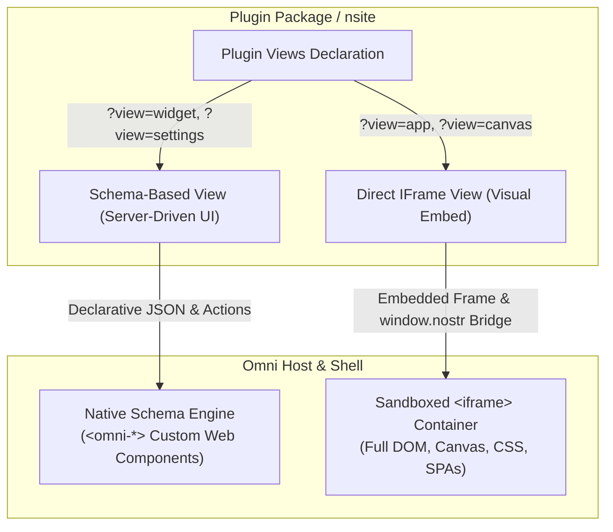
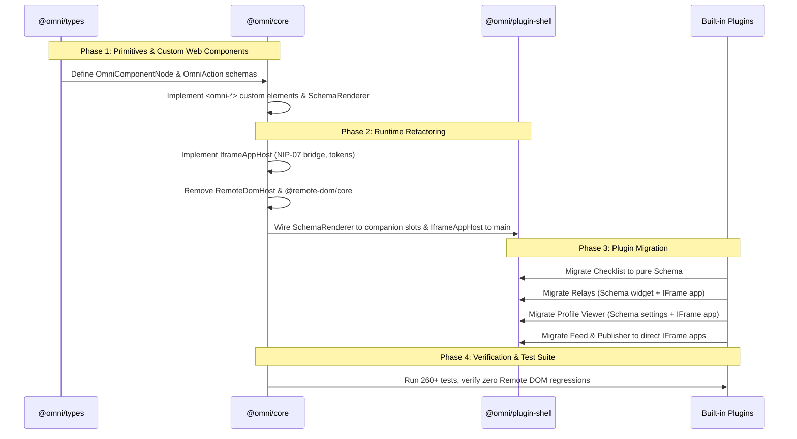

# Omni Architecture Migration Plan: Hybrid Schema-Driven UI & Direct IFrame Runtime

> **Target Architecture**: Transitioning from `@remote-dom/core` to a dual-runtime model:
> 1. **Declarative Component Schema (Server-Driven UI)** for companion widgets, settings, dock shortcuts, and cards.
> 2. **Direct Visual `<iframe>` Runtime** for full-page apps, interactive tools, and standard Nostr nsites.
>
> *Status: Approved Architecture Plan*  
> *Date: October 2026*

---

## 1. Executive Summary & Motivation

Currently, Omni plugins execute within sandboxed environments and project their UI into host viewports using `@remote-dom/core`. While conceptually flexible, running a synthetic DOM mirror over asynchronous IPC channels introduces significant structural friction:
- **Detached Tree & Mutation Race Conditions**: Node creation, property assignments, and DOM attachment order must be meticulously choreographed (`isConnected()` checks, synthetic event bridging).
- **Style Collision & Scope Bleed**: Host shell styles and guest stylesheets frequently conflict or fail to cascade properly across the projection barrier.
- **Developer & Debugging Overhead**: Inspecting projected DOM in browser DevTools disconnects the visual output from the actual running JavaScript in the guest iframe.

### The New Hybrid Model

Omni plugins will declare views categorized into two distinct runtime paradigms:



1. **Schema-Based UI (Server-Driven UI)**:
   - **Use Case**: Compact surfaces where design harmony and performance are paramount—widgets dashboard cards, navigation dock companions, header quick actions, and settings forms.
   - **Mechanism**: The plugin logic emits structured JSON component trees. The Omni shell renders them natively using Omni's design tokens and custom web component primitives (`<omni-card>`, `<omni-button>`, `<omni-list>`, etc.).
   - **Interactivity**: User interactions (clicks, inputs, toggles, form submits, scroll-to-bottom) dispatch strongly typed actions over JSON-RPC back to the plugin.

2. **Direct Visual IFrame UI**:
   - **Use Case**: Rich, autonomous full-page applications—timelines, composers, plugin studios, media players, games, and standard external Nostr nsites.
   - **Mechanism**: The shell mounts a real, visually embedded `<iframe sandbox="allow-scripts allow-forms">` directly in the primary `main` viewport.
   - **Capabilities**: Unrestricted browser capabilities (Canvas, WebGL, CSS animations, custom SPA frameworks like React/Svelte/Vue, native text selection, native scrolling) with zero Remote DOM emulation layer. Host Keystore (`window.nostr`) and design tokens are bridged transparently.

---

## 2. List of Primitives

The initial primitive set is designed to support 100% of the functionality currently present in Omni's built-in plugins (Checklist, Relays, Profile Viewer, Feed, Publisher, and Settings):

### A. Layout & Structure
* `box`: Flexible container supporting direction (`row` | `column`), alignment, justify, gap, wrap, and padding.
* `card`: Elevated card container (`var(--omni-bg-elevated)`) with title, subtitle, icon, actions header slot, body, and footer.
* `divider`: Subtle horizontal or vertical separator (`var(--omni-border-subtle)`).
* `spacer`: Fixed or flexible spacing token (`xs`, `sm`, `md`, `lg`, `xl`).

### B. Typography & Status Display
* `text`: Semantic typography with variants (`heading-1`, `heading-2`, `heading-3`, `body`, `caption`, `mono`), muted tones, and truncation.
* `badge`: Status indicator pill with tone (`neutral`, `success`, `warning`, `error`, `accent`) and optional pulse dot.
* `metric`: Dashboard stat tile showing a prominent value, label, and optional trend indicator (`up`, `down`, `neutral`).
* `icon`: Geometric monochrome line SVG icon (from Omni's unified icon registry).
* `avatar`: User profile picture (pubkey or image URL) with fallback monochrome silhouette and npub badge.

### C. Interactive Controls & Actions
* `button`: Primary, secondary, ghost, and danger action buttons with loading indicators, disabled states, and icons.
* `icon-button`: Compact clickable icon button with hover tooltip and accessibility label.
* `link`: Hyperlink or protocol trigger (`nostr:`, `lightning:`, `https://`) with routing target.

### D. Form Inputs & State Capture
* `input`: Single-line text, number, search, or URL input with placeholder, value, clear button, and prefix/suffix icons.
* `textarea`: Multi-line text field with autogrow.
* `toggle`: Switch/checkbox input for boolean preferences.
* `select`: Dropdown picker for selecting options.

### E. Collections & Feeds
* `list`: Collection container for repeated items with row separator styling and scroll-to-bottom infinite triggers.
* `list-item`: Composed row with leading slot (icon/avatar/checkbox), title, subtitle/meta, trailing slot (actions/badges), and row click action.
* `empty-state`: Centered placeholder graphic, title, description, and primary call-to-action button.

---

## 3. JSON Schema for Primitives

The canonical TypeScript interface for schema-based views:

```typescript
export type OmniPrimitiveType =
  | "box"
  | "card"
  | "divider"
  | "text"
  | "badge"
  | "metric"
  | "icon"
  | "avatar"
  | "button"
  | "icon-button"
  | "input"
  | "textarea"
  | "toggle"
  | "select"
  | "list"
  | "list-item"
  | "empty-state";

export interface OmniAction {
  name: string;
  payload?: Record<string, unknown>;
  navigate?: {
    pluginId?: string;
    view?: string;
    route?: string;
  };
}

export interface OmniPrimitiveBase {
  id?: string;
  key?: string;
  visible?: boolean;
}

export interface OmniBoxPrimitive extends OmniPrimitiveBase {
  type: "box";
  direction?: "row" | "column";
  gap?: "none" | "xs" | "sm" | "md" | "lg";
  align?: "start" | "center" | "end" | "stretch";
  justify?: "start" | "center" | "between" | "end";
  wrap?: boolean;
  padding?: "none" | "xs" | "sm" | "md" | "lg";
  children: OmniComponentNode[];
}

export interface OmniCardPrimitive extends OmniPrimitiveBase {
  type: "card";
  title?: string;
  subtitle?: string;
  icon?: string;
  headerAction?: OmniComponentNode;
  children: OmniComponentNode[];
  footer?: OmniComponentNode[];
}

export interface OmniTextPrimitive extends OmniPrimitiveBase {
  type: "text";
  content: string;
  variant?: "title" | "subtitle" | "body" | "caption" | "mono";
  tone?: "primary" | "secondary" | "muted" | "accent" | "error" | "success";
  truncate?: boolean;
}

export interface OmniBadgePrimitive extends OmniPrimitiveBase {
  type: "badge";
  label: string;
  tone?: "neutral" | "success" | "warning" | "error" | "accent";
  variant?: "solid" | "subtle" | "outline";
  dot?: boolean;
}

export interface OmniMetricPrimitive extends OmniPrimitiveBase {
  type: "metric";
  label: string;
  value: string | number;
  subtext?: string;
  trend?: "up" | "down" | "neutral";
}

export interface OmniButtonPrimitive extends OmniPrimitiveBase {
  type: "button";
  label: string;
  action: OmniAction;
  variant?: "primary" | "secondary" | "ghost" | "danger";
  size?: "sm" | "md" | "lg";
  icon?: string;
  iconPosition?: "left" | "right";
  disabled?: boolean;
  loading?: boolean;
}

export interface OmniInputPrimitive extends OmniPrimitiveBase {
  type: "input";
  name: string;
  placeholder?: string;
  value?: string;
  inputType?: "text" | "number" | "search" | "url";
  clearable?: boolean;
  prefixIcon?: string;
  actionOnEnter?: OmniAction;
}

export interface OmniTogglePrimitive extends OmniPrimitiveBase {
  type: "toggle";
  name: string;
  label?: string;
  checked: boolean;
  action: OmniAction;
  disabled?: boolean;
}

export interface OmniListPrimitive extends OmniPrimitiveBase {
  type: "list";
  items: OmniListItemPrimitive[];
  onScrollEndAction?: OmniAction;
  hasMore?: boolean;
  loadingMore?: boolean;
}

export interface OmniListItemPrimitive extends OmniPrimitiveBase {
  type: "list-item";
  title: string;
  subtitle?: string;
  meta?: string;
  icon?: string;
  avatarUrl?: string;
  checked?: boolean;
  onCheckAction?: OmniAction;
  onClickAction?: OmniAction;
  actions?: OmniComponentNode[];
}

export type OmniComponentNode =
  | OmniBoxPrimitive
  | OmniCardPrimitive
  | OmniTextPrimitive
  | OmniBadgePrimitive
  | OmniMetricPrimitive
  | OmniButtonPrimitive
  | OmniInputPrimitive
  | OmniTogglePrimitive
  | OmniListPrimitive
  | OmniListItemPrimitive
  | { type: "divider" }
  | { type: "icon"; name: string; size?: number };

export interface OmniSchemaViewResponse {
  schemaVersion: "1.0";
  root: OmniComponentNode;
}
```

---

## 4. Custom Web Components Implementation Strategy

### Decision: Native Autonomous Custom Elements with Light DOM

Rather than using third-party component suites (such as Web Awesome or Shoelace) which introduce heavy bundles (~300KB+) and conflicting design systems, Omni will implement **Native Autonomous Custom Elements** (`customElements.define("omni-card", OmniCardElement)`):

1. **Light DOM for Theme Inheritance**:
   By attaching directly to the Light DOM instead of Shadow DOM boundaries, primitives inherit the host shell's CSS variables (`var(--omni-bg-surface)`, `var(--omni-text-primary)`) without CSS bleeding or piercing workarounds.
2. **Standard Custom Elements API**:
   Each primitive is a registered custom element:
   - `<omni-box>`
   - `<omni-card>`
   - `<omni-text>`
   - `<omni-badge>`
   - `<omni-metric>`
   - `<omni-button>`
   - `<omni-input>`
   - `<omni-toggle>`
   - `<omni-list>`
   - `<omni-list-item>`
3. **Dual Capability**:
   - The **Schema Engine** uses these custom elements to render JSON component trees.
   - The **Host Shell UI** itself can directly use these same custom elements for native pages and dialogues, eliminating duplicated HTML construction logic across the codebase.

---

## 5. Handling Interactivity & Protocols

| Interaction | Schema-Based Views | Direct IFrame Views |
| :--- | :--- | :--- |
| **Click / Tap** | `action` payload dispatched via JSON-RPC `omni.action` to plugin background worker. | Native DOM click listener inside iframe. |
| **Input / Form Submit** | Form state captured natively in `<omni-input>`. Submit/Enter emits payload with input values. | Standard `<form>` / SPA state management inside iframe. |
| **Hover & Focus** | Native `:hover` / `:focus-visible` pseudo-classes on custom elements with tooltip triggers. | Native browser CSS hover/focus states. |
| **Infinite Scroll** | `<omni-list>` maintains an internal `IntersectionObserver` on a footer sentinel element; triggers `onScrollEndAction` when in view. | Standard `window.onscroll` or `IntersectionObserver` inside iframe. |
| **NIP-07 Keystore** | Plugin background worker interacts directly with host keystore via kernel JSON-RPC. | Host keystore shim injected into iframe (`window.nostr` proxy) routing to host keystore. |
| **Protocol Navigation** | Actions return `navigate: { route: "nostr:..." }` routing to Shell intent chooser. | `<a href="nostr:...">` intercepted by guest bridge and routed via postMessage to host intent chooser. |

---

## 6. Styling Architecture & Design Tokens

### Schema Views:
- Styled via `packages/plugins/shell/src/styles/schema-styles.ts`.
- Uses host CSS variables:
  - Canvas: `--omni-bg-canvas: #141312`
  - Surface: `--omni-bg-surface: #191816`
  - Elevated: `--omni-bg-elevated: #22201d`
  - Primary text: `--omni-text-primary: #ede8df`
  - Accent: `--omni-accent-primary: #d4a373`
- Responsive and layout-agnostic: adapts seamlessly whether rendered inside a 320px widget slot or a 600px settings drawer.

### Direct IFrame Views:
- Host injects `omni-tokens.css` into iframe document or passes tokens via postMessage handshake.
- IFrame apps use CSS custom properties directly for visual consistency without being forced into host styling constraints.

---

## 7. Migration Plan for Built-in Plugins

| Plugin | Target View Types | View Details |
| :--- | :--- | :--- |
| **`@omni/plugin-checklist`** | **Schema View** | Daily checklist widget emitting `<omni-card>` with task inputs and interactive `<omni-list>`. |
| **`@omni/plugin-relays`** | **Schema View + IFrame View** | • `view=widget`: Schema summary card (active relay count badge, latency metric).<br>• `view=app`: Direct IFrame for live WebSocket inspector, ping graphs, and pool configuration. |
| **`@omni/plugin-profile-viewer`** | **Schema View + IFrame View** | • `view=settings`: Schema-based profile editor form.<br>• `view=app`: Direct IFrame people directory and profile explorer. |
| **`@omni/plugin-feed`** | **IFrame View + Schema View** | • `view=app`: Direct IFrame for rich timeline, thread trees, note composer, and search.<br>• `view=widget`: Schema summary card of recent notifications/notes. |
| **`@omni/plugin-publisher`** | **IFrame View** | Direct IFrame for Plugin Studio, zip drag-and-drop, Blossom upload progress, and naddr generator. |

---

## 8. Phased Implementation Roadmap



### Phase 1: Schema Types & Custom Web Components
1. Add schema definitions to `packages/types/src/schema.ts` and export from `packages/types/src/index.ts`.
2. Implement custom elements in `packages/core/src/schema/components/`:
   - `OmniBoxElement`, `OmniCardElement`, `OmniButtonElement`, `OmniInputElement`, `OmniListElement`, etc.
3. Implement `SchemaRenderer` in `packages/core/src/schema/schema-renderer.ts`.
4. Add unit test suite in `packages/core/test/schema-renderer.test.ts`.

### Phase 2: Core Runtime Refactoring
1. Implement `IframeAppHost` in `packages/core/src/sandbox/iframe-app-host.ts`:
   - Sandboxed iframe creation (`allow-scripts allow-forms`).
   - Host keystore bridge (`window.nostr` postMessage relay).
   - Design tokens stylesheet injection.
2. Update `SandboxManager`:
   - Route companion slots (`sidebar`, `header-actions`, `dock`, `settings`) to `SchemaRenderer`.
   - Route full-page viewports (`main`) to `IframeAppHost`.
3. Deprecate and remove `RemoteDomHost` and `@remote-dom/core`.

### Phase 3: Shell Integration & Styles
1. Integrate `SchemaRenderer` into `BaseShell`, `OmniShell`, `PanoramaShell`, and `EditorialShell`.
2. Bundle primitive styles in `packages/plugins/shell/src/styles/schema-styles.ts`.
3. Verify companion viewport mapping in `LayoutManager`.

### Phase 4: Plugin Migrations
1. Rewrite `@omni/plugin-checklist` as a pure Schema-driven widget.
2. Migrate `@omni/plugin-relays` (Schema widget + IFrame full-page manager).
3. Migrate `@omni/plugin-profile-viewer` (Schema settings + IFrame people browser).
4. Migrate `@omni/plugin-feed` and `@omni/plugin-publisher` to direct IFrame applications.

### Phase 5: Documentation & Verification
1. Update `AGENTS.md`, `docs/01-architecture.md`, and `docs/03-plugin-developer-guide.md`.
2. Update all plugin and core test suites.
3. Verify clean build (`pnpm -r run build`) and test execution (`pnpm test`).

---

## 9. Verification & Testing Strategy

- **Schema Renderer Unit Tests**: Validate rendering of every primitive, attribute updates, event action dispatching, and form state collection.
- **Infinite Scroll Tests**: Validate that `<omni-list>` triggers `onScrollEndAction` when sentinel intersects viewport.
- **IFrame Bridge Tests**: Test NIP-07 `getPublicKey` and `signEvent` message passing between guest iframe and host Keystore.
- **Integration Tests**: Verify Checklist widget task completion, Relays pool metrics, and Feed timeline rendering without `@remote-dom`.
- **Monorepo Build**: Ensure clean TypeScript compilation across all packages and plugins with zero type errors.
